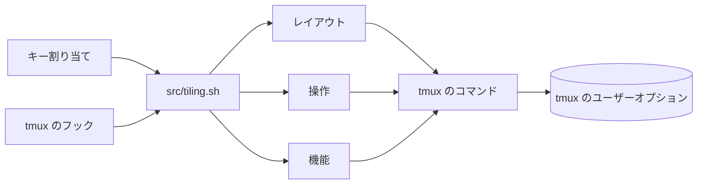

<div align="center">

# tmux-tiling-revamped

<strong>tmuxのタイル型ウィンドウ管理です。BSPのdwindleとspiralを含む8つのレイアウトと、レイアウトの取り消しがあります。</strong>

[English](README.md) &nbsp;|&nbsp; 日本語 &nbsp;|&nbsp; [简体中文](README.zh-Hans.md) &nbsp;|&nbsp; [繁體中文（香港）](README.zh-HK.md)

[](https://github.com/tmux-revamped/tmux-tiling-revamped/actions/workflows/tests.yml)
[](LICENSE)
[](CHANGELOG.md)

<p align="center">
  <a href="#機能">機能</a> &nbsp;|&nbsp;
  <a href="#動作要件">動作要件</a> &nbsp;|&nbsp;
  <a href="#インストール">インストール</a> &nbsp;|&nbsp;
  <a href="#使い方">使い方</a> &nbsp;|&nbsp;
  <a href="#設定">設定</a> &nbsp;|&nbsp;
  <a href="#キーバインド">キーバインド</a> &nbsp;|&nbsp;
  <a href="#仕組み">仕組み</a>
</p>

</div>

レイアウトが**8**つ。操作が**19**個。既定のキーが**26**個で、すべて`M-`と英大文字の組み合わせであり、tmux標準のキーは1つもありません。取り消しはウィンドウごとに最大**10**段階です。

---

## 機能

このプラグインはウィンドウ内のペインをレイアウトに沿って並べ、ペインの追加、終了、サイズ変更の後もそのレイアウトを保ちます。BSPのレイアウトは、tmuxのレイアウト文字列をbashで計算し、1回の`select-layout`呼び出しで適用します。

| レイアウト | 配置 |
|:-------|:------------|
| `dwindle` | 二分空間分割。新しいペインは残りの領域の半分を取り、角に向かって分割していきます |
| `spiral` | 同じ分割で、深さごとにペインの順序を逆にします |
| `grid` | tmuxの均等な`tiled`レイアウト |
| `main-center` | 幅の広い中央のペインと、残りのペインを左右の列に均等に分けたもの |
| `main-vertical` | 左にマスターペインを幅の`@tiling_revamped_master_ratio`パーセントで置き、右に残りを積みます |
| `main-horizontal` | 上にマスターペインを高さの同じ割合で置き、下に残りを積みます |
| `monocle` | フォーカスしたペインを拡大します。同じコマンドをもう一度実行すると元に戻ります |
| `deck` | すべてのペインを全高にし、同じ幅で横に並べます |

レイアウト以外にも、promote、rotate、flip、circulate、swapなどのペイン操作、名前付きのペインのマーク、スクラッチパッドのポップアップ、保存したプリセット、i3風のワークスペース、fzfのレイアウトピッカー、セッションをまたぐペインジャンパー、フォーカス履歴、ウィンドウごとの取り消しとやり直しがあります。

## 動作要件

| ツール | バージョン | 備考 |
|:-----|:--------|:------|
| tmux | 3.2以降 | 古いtmuxでは読み込み時にメッセージを出し、何も割り当てません |
| bash | 4.0以降 | エントリーポイントが連想配列を使います。macOSの`/bin/bash` 3.2ではメッセージを出して何も割り当てないので、`brew install bash`で新しいbashを入れてください |
| fzf | 任意 | レイアウトピッカー、ペインジャンパー、スワップピッカー、プロジェクトランチャー、名前なしでのマークやプリセットの選択に使います。fzf 0.53.0以降は`--tmux`で開きます。それより古いfzfは`display-popup`の中で動きます |
| fd | 任意 | プロジェクトの検索が速くなります。なければランチャーは`find`を使います |

CIは、Ubuntu LTSのx86_64とarm64でGNUとuutilsのcoreutilsを使い、macOSのApple SiliconとIntelでシステムのツール、GNUのツール、uutilsを使ってテストを実行します。

## インストール

[TPM](https://github.com/tmux-plugins/tpm)を使う場合は、次の行を`~/.tmux.conf`に追加して`prefix + I`を押します。

```tmux
set -g @plugin 'tmux-revamped/tmux-tiling-revamped'
```

TPMを使わない場合は、リポジトリをクローンし、設定からエントリーポイントを実行します。

```bash
git clone https://github.com/tmux-revamped/tmux-tiling-revamped ~/.tmux/plugins/tmux-tiling-revamped
```

```tmux
run-shell ~/.tmux/plugins/tmux-tiling-revamped/tmux-tiling-revamped.tmux
```

ペインをいくつか開いて`prefix + M-D`を押します。プレフィックスの後にAlt、Shift、`d`を押す操作です。ペインがdwindleレイアウトに並び替わり、新しいペインもそこに加わります。

## 使い方

どのキーも[`src/tiling.sh`](src/tiling.sh)のコマンドを実行します。同じコマンドをシェル、スクリプト、自分のキー割り当てから呼べます。

```bash
~/.tmux/plugins/tmux-tiling-revamped/src/tiling.sh layout dwindle brvc
~/.tmux/plugins/tmux-tiling-revamped/src/tiling.sh rotate 180
~/.tmux/plugins/tmux-tiling-revamped/src/tiling.sh preset save dev
~/.tmux/plugins/tmux-tiling-revamped/src/tiling.sh help
```

| 分類 | コマンド |
|:------|:---------|
| レイアウト | `layout dwindle [flags]`、`layout spiral [flags]`、`layout grid`、`layout main-center`、`layout main-vertical`、`layout main-horizontal`、`layout monocle`、`layout deck` |
| 操作 | `balance`、`equalize`、`rotate [90,180,270]`、`flip [h,v]`、`promote`、`circulate [next,prev]`、`autosplit`、`focus-resize`、`resize-master [grow,shrink]`、`sync`、`swap [U,D,L,R]`、`swap-pick`、`swap-biggest`、`pick`、`cycle [next,prev]`、`undo`、`redo`、`smart-borders`、`pane-jump` |
| 機能 | `mark <name>`、`unmark [name]`、`jump [name]`、`scratchpad [name] [command]`、`preset save <name>`、`preset apply [name]`、`workspace <N>`、`move-to-workspace <N>`、`back-and-forth`、`project`、`focus-back`、`focus-forward` |
| 自動化 | `dynamic-layout`、`app-rules`、`focus-record` |
| 診断 | `info`、`status`、`help-overlay`、`doctor`、`validate [fix]`、`restore-layouts`、`help` |

### BSPの向き

`dwindle`と`spiral`は4文字のフラグ文字列を受け取り、組み合わせは全部で16通りです。既定は`brvc`です。

| 位置 | 値 | 意味 |
|:---------|:-------|:--------|
| 1 | `t`、`b` | 上か下に向かって分割 |
| 2 | `l`、`r` | 左か右に向かって分割 |
| 3 | `h`、`v` | 最初の分割が水平か垂直か |
| 4 | `c`、`s` | 角、つまりdwindleか、spiralか |

`@tiling_revamped_split_ratio`は最初の分割を20から80パーセントの範囲で設定し、ウルトラワイドの画面で役立ちます。

### 自動レイアウト

`@tiling_revamped_auto_apply`が既定の`1`なら、分割、終了、プロセス終了、サイズ変更のフックがウィンドウのレイアウトを適用し直します。`set -w`で設定する`@tiling_revamped_enabled`で、ウィンドウごとにこれを有効または無効にできます。

`@tiling_revamped_dynamic_layout`はペインの数からレイアウトを選びます。`1:monocle 2:main-vertical 3:dwindle 5:grid`なら、ペインが4つのウィンドウはdwindleになります。

`@tiling_revamped_app_rules`には、新しいペインのコマンドにグロブとして照合する、改行区切りの`pattern:action`規則を書きます。最初に一致したものが使われます。`master`はそのペインをマスターにし、`float`と`scratchpad`はペインのオプションで印を付けます。

### ステータスライン

現在のレイアウト名はウィンドウのオプション`@tiling_revamped_layout`にあります。

```tmux
set -g status-right '#{@tiling_revamped_layout} | %H:%M'
```

`src/tiling.sh status`は、8つのレイアウトそれぞれのグリフを付けて名前を表示します。

### ワークスペースとナビゲーション

これらはルートテーブルにAltのキーを割り当てるので、次の両方のオプションを`1`にする必要があります。

```tmux
set -g @tiling_revamped_alt_keys '1'
set -g @tiling_revamped_workspaces '1'
```

`M-1`から`M-9`はその番号のウィンドウに切り替え、なければ作成します。`M-0`はウィンドウ10に移ります。Altとシフトした数字の組み合わせは、ペインをそのウィンドウに移します。`@tiling_revamped_shiftnum`にはキーボード配列に合わせたシフト後の文字を並べ、既定は`!@#$%^&*()`です。`M-Tab`は直前のウィンドウに戻ります。

`@tiling_revamped_navigator '1'`はルートテーブルに`M-h`、`M-j`、`M-k`、`M-l`を割り当ててペイン間を移動し、ペインでvim、neovim、fzfが動いているときはキーをそのまま渡します。

## 設定

| オプション | 既定値 | 意味 |
|:-------|:--------|:--------|
| `@tiling_revamped_auto_apply` | `1` | ペインの追加、削除、サイズ変更でレイアウトを適用し直す |
| `@tiling_revamped_enabled` | 空 | ウィンドウのオプション。`1`ならそのウィンドウで適用し直し、それ以外の値なら適用しない |
| `@tiling_revamped_dynamic_layout` | 空 | 空白区切りの`count:layout`の組 |
| `@tiling_revamped_app_rules` | 空 | 改行区切りの`pattern:action`規則 |
| `@tiling_revamped_default_layout` | 空 | 新しいウィンドウすべてに適用するレイアウト |
| `@tiling_revamped_default_orientation` | `brvc` | ウィンドウにフラグがないときのBSPのフラグ |
| `@tiling_revamped_split_ratio` | `50` | BSPの最初の分割、20から80 |
| `@tiling_revamped_master_ratio` | `60` | main-verticalとmain-horizontalのマスターの大きさ、20から90 |
| `@tiling_revamped_main_center_ratio` | `60` | main-centerの中央の幅、20から90 |
| `@tiling_revamped_resize_step` | `5` | マスターを大きくまたは小さくする1回あたりのパーセント |
| `@tiling_revamped_focus_resize` | `0` | `1`でフォーカスしたペインを大きくする |
| `@tiling_revamped_focus_ratio` | `62` | フォーカスしたペインの大きさ、パーセント |
| `@tiling_revamped_focus_history` | `0` | `1`で戻る、進むのキーのためにフォーカスを記録 |
| `@tiling_revamped_focus_max` | `20` | ウィンドウごとの履歴の件数、2から500 |
| `@tiling_revamped_cycle_layouts` | `dwindle spiral grid main-vertical main-horizontal main-center monocle deck` | 切り替えの順序 |
| `@tiling_revamped_alt_keys` | `0` | `1`でプレフィックスの後ではなく、ルートテーブルにAltでキーを割り当てる |
| `@tiling_revamped_navigator` | `0` | `1`でvimを考慮した`M-h`、`M-j`、`M-k`、`M-l`を割り当てる |
| `@tiling_revamped_workspaces` | `0` | `1`で`@tiling_revamped_alt_keys`と合わせてワークスペースのキーを割り当てる |
| `@tiling_revamped_shiftnum` | `!@#$%^&*()` | Shiftと1から0で入力される文字 |
| `@tiling_revamped_project_dir` | 空 | プロジェクトランチャーの起点 |
| `@tiling_revamped_project_depth` | `1` | プロジェクトを探すディレクトリの深さ |
| `@tiling_revamped_scratch_width` | `80%` | スクラッチパッドのポップアップの幅 |
| `@tiling_revamped_scratch_height` | `75%` | スクラッチパッドのポップアップの高さ |
| `@tiling_revamped_pick_width` | `60%` | レイアウトピッカーの幅 |
| `@tiling_revamped_pick_height` | `40%` | レイアウトピッカーの高さ |
| `@tiling_revamped_pick_preview_width` | `60%` | レイアウトピッカーのプレビューの幅 |
| `@tiling_revamped_jump_width` | `70%` | ペインジャンパーの幅 |
| `@tiling_revamped_jump_height` | `60%` | ペインジャンパーの高さ |
| `@tiling_revamped_jump_preview_width` | `60%` | ペインジャンパーのプレビューの幅 |
| `@tiling_revamped_help_width` | `50%` | ヘルプオーバーレイの幅 |
| `@tiling_revamped_help_height` | `60%` | ヘルプオーバーレイの高さ |
| `@tiling_revamped_smart_borders` | `0` | `1`でペインが1つの間はペインの境界を隠す |
| `@tiling_revamped_border_status` | `top` | 2つ目のペインができたときに戻す`pane-border-status` |
| `@tiling_revamped_warn_conflicts` | `1` | `0`で読み込み時のキー衝突のメッセージを出さない |
| `@tiling_revamped_enable_logging` | `0` | `1`でエラーを`~/.tmux/tiling-revamped-logs/tiling-revamped.log`に書き込む |

### 内部状態

これらのオプションはプラグインが管理します。設定しないでください。ただしプリセットは、同じ形式で手で書いてもかまいません。

| オプション | スコープ | 保持する内容 |
|:-------|:------|:------|
| `@tiling_revamped_layout` | window | 現在のレイアウト名 |
| `@tiling_revamped_orientation` | window | BSPのフラグ |
| `@tiling_revamped_layout_history` | window | 取り消しのスタック、最大10件 |
| `@tiling_revamped_layout_redo` | window | やり直しのスタック |
| `@tiling_revamped_monocle_prev_layout` | window | monocleを解除したときに戻すレイアウト |
| `@tiling_revamped_applying` | window | レイアウトの適用を始めた秒。フックはその間の並べ直しを飛ばします。10秒を過ぎると無視します |
| `@tiling_revamped_focus_stack` | window | フォーカスしたペインのID、古い順 |
| `@tiling_revamped_focus_pos` | window | フォーカスのスタック内の位置 |
| `@tiling_revamped_focus_nav` | window | 戻る、進むの移動中は`1`で、その移動を記録しません |
| `@tiling_revamped_mark` | pane | ペインのマーク名 |
| `@tiling_revamped_float` | pane | アプリの規則で`float`の印を付けたペインでは`1` |
| `@tiling_revamped_scratchpad` | pane | アプリの規則で`scratchpad`の印を付けたペインでは`1` |
| `@tiling_revamped_marks` | global | すべての`name:pane`のマーク |
| `@tiling_revamped_last_window` | global | 最後に離れたウィンドウ。`M-Tab`で使います |
| `@tiling_revamped_bindings` | global | 各機能と、衝突の解決後にそれが持つキー |
| `@tiling_revamped_conflicts` | global | 読み込み時に解決したすべてのキー衝突 |
| `@tiling_revamped_preset_<name>` | global | `layout:flags:ratio`形式のプリセット。例: `dwindle:brvc:60` |

## キーバインド

既定のキーはすべて、`prefix`の後に`M-`と英大文字を押すものです。この範囲はtmux標準では割り当てがなく、tmux-revampedファミリーがこのプラグインのために確保しています。各キーには`@tiling_revamped_key_<action>`のオプションがあり、空文字列にすると割り当てを外せます。

| キー | 動作 | オプション |
|:----|:-------|:-------|
| `M-A` | 長い方の軸に沿って分割 | `@tiling_revamped_key_autotile` |
| `M-B` | レイアウト内でペインを均す | `@tiling_revamped_key_balance` |
| `M-C` | ペインを循環 | `@tiling_revamped_key_circulate` |
| `M-D` | dwindleレイアウト | `@tiling_revamped_key_dwindle` |
| `M-E` | ペインを均等にする | `@tiling_revamped_key_equalize` |
| `M-F` | レイアウトを反転 | `@tiling_revamped_key_flip` |
| `M-G` | マスターペインを大きくする | `@tiling_revamped_key_master_grow` |
| `M-H` | main-horizontalレイアウト | `@tiling_revamped_key_main_horizontal` |
| `M-I` | ヘルプオーバーレイ | `@tiling_revamped_key_help` |
| `M-J` | マークしたペインに移動 | `@tiling_revamped_key_jump` |
| `M-K` | 名前を尋ねてペインにマーク | `@tiling_revamped_key_mark` |
| `M-L` | レイアウトピッカー | `@tiling_revamped_key_pick_layout` |
| `M-M` | ペインをマスターにする | `@tiling_revamped_key_promote` |
| `M-N` | 履歴でフォーカスを進める | `@tiling_revamped_key_focus_forward` |
| `M-O` | レイアウトを切り替え | `@tiling_revamped_key_cycle` |
| `M-P` | 履歴でフォーカスを戻す | `@tiling_revamped_key_focus_back` |
| `M-Q` | 任意のセッションの任意のペインに移動 | `@tiling_revamped_key_pane_jump` |
| `M-R` | レイアウトを回転 | `@tiling_revamped_key_rotate` |
| `M-S` | spiralレイアウト | `@tiling_revamped_key_spiral` |
| `M-T` | スクラッチパッドのポップアップ | `@tiling_revamped_key_scratchpad` |
| `M-U` | 最後のレイアウト変更を取り消す | `@tiling_revamped_key_undo` |
| `M-V` | main-verticalレイアウト | `@tiling_revamped_key_main_vertical` |
| `M-W` | 最も大きいペインと入れ替え | `@tiling_revamped_key_swap_biggest` |
| `M-X` | マスターペインを小さくする | `@tiling_revamped_key_master_shrink` |
| `M-Y` | ペインの同期を切り替え | `@tiling_revamped_key_sync` |
| `M-Z` | やり直し | `@tiling_revamped_key_redo` |

既定で割り当てないもの: 方向を指定する入れ替えの`@tiling_revamped_key_swap_up`、`@tiling_revamped_key_swap_down`、`@tiling_revamped_key_swap_left`、`@tiling_revamped_key_swap_right`。プロジェクトランチャーの`@tiling_revamped_key_project`で、これには`@tiling_revamped_project_dir`も必要です。そして`@tiling_revamped_key_pick_layout_alt`で、Altとそのキーをルートテーブルでレイアウトピッカーに割り当て、vimやfzfの中ではキーをそのまま渡します。`@tiling_revamped_key_back_and_forth`は`Tab`で、ワークスペースモードでのみ`M-Tab`として有効です。

3.0.0より前の既定は、dwindleの`d`のような単独のキーで、その多くはtmux標準のキーでした。[`CHANGELOG.md`](CHANGELOG.md)に、古いキーと新しいキーの対応がすべて載っています。古いキーを使い続けるには、そのオプションを設定します。

```tmux
set -g @tiling_revamped_key_dwindle 'd'
```

2つの動作が同じキーになった場合は、自分で設定したキーが既定のキーに勝ち、負けた動作は割り当てなしのままになります。プラグインは読み込み時に衝突を報告し、`@tiling_revamped_conflicts`に保存します。`@tiling_revamped_alt_keys '1'`のときは、`M-`で始まるキーはそのままルートテーブルに割り当てるので既定のキーはプレフィックスなしで使え、`d`のような単独のキーは`M-d`として割り当てます。

`M-I`は、レイアウト、ペイン、マーク、スクラッチパッド、取り消し、ペインジャンパー、フォーカス履歴のキーを、衝突の解決後に持つキーとともに一覧するポップアップを開きます。

## 仕組み



[`tmux-tiling-revamped.tmux`](tmux-tiling-revamped.tmux)は、bashとtmuxのバージョンを確認し、すべてのキー割り当てを登録簿に集め、衝突を解決し、割り当てを書き込み、必要なオプションのためにフックを設定します。状態はウィンドウ、ペイン、グローバルのスコープのtmuxユーザーオプションに置き、一時ファイルは使いません。

BSPのレイアウトは3つの手順で適用します。

1. `_bsp_build`がウィンドウを二分木に分けます。フラグが各分割の向きを決め、`@tiling_revamped_split_ratio`が最初の分割を決めます。結果は`200x50,0,0{100x50,0,0,0,100x50,101,0[...]}`のようなtmuxのレイアウト文字列です。
2. `_layout_checksum`が、tmuxがカスタムレイアウトの先頭に求める16ビットのチェックサムを計算します。
3. 1回の`select-layout`呼び出しですべてのペインを配置します。spiralでは、その後`_bsp_fix_pane_order`がペインをspiralの位置に入れ替えます。

フックは発生したウィンドウを渡すので、バックグラウンドのウィンドウのフックが、見ているウィンドウを並べ直すことはありません。レイアウトの適用中は、`@tiling_revamped_applying`がフックによる再度の並べ直しを止めます。

`doctor`は環境を確認します。`info`はウィンドウのレイアウトの状態を表示します。`validate`はペインが1つしかないのにレイアウトが記録されたウィンドウで失敗し、`validate fix`はその記録を消します。`restore-layouts`はすべてのセッションの各ウィンドウに保存したレイアウトを適用し直すもので、tmux-resurrectでセッションを戻した後に使います。

## 開発

| コマンド | 実行するもの |
|:--------|:-------------|
| `make test` | batsのテストスイート、単体と結合 |
| `make test-unit` | [`test/lib`](test/lib)配下の単体テスト |
| `make lint` | すべてのシェルファイルに対するwarningレベルのshellcheck |
| `make coverage` | 下限95パーセントのkcovによる行カバレッジ、Linuxのみ |
| [`family/bin/audit`](family/bin/audit) | ファミリーの規約に対するこのリポジトリの検査 |

[`test/docs.bats`](test/docs.bats)は、コードが読まないオプションがこのREADMEに書かれていると失敗します。貢献の手引きは[`CONTRIBUTING.md`](CONTRIBUTING.md)にあります。

## ライセンス

[MIT](LICENSE)

<!-- family:begin -->

## tmux-revamped ファミリー

このプラグインは tmux-revamped ファミリーの一員です。すべてのメンバーが [`FAMILY.md`](FAMILY.md) の同じ規約、`family/` 配下の同じツール、同じ共有ライブラリを持ち、チェックサムの一覧によってバイト単位で同一に保たれています。メンバーは一緒にインストールする前提で作られており、ほかのメンバーが使うキーや tmux オプションを使うメンバーはありません。

あるメンバーで見つかった不具合は、修正完了とする前に全メンバーで同じ不具合を探します。この義務は記憶に頼らず規約に書かれており、`family/bin/sweep` がその作業を行います。

| メンバー | 機能 |
|---|---|
| [`tmux-autoreload-revamped`](https://github.com/tmux-revamped/tmux-autoreload-revamped) | tmuxの設定を編集して保存するだけで、キーもコマンドも使わずに自動で再読み込みされます |
| [`tmux-battery-revamped`](https://github.com/tmux-revamped/tmux-battery-revamped) | tmuxのステータスバーに電池の状態を表示し、ステータスの描画を一切止めません |
| [`tmux-bluetooth-revamped`](https://github.com/tmux-revamped/tmux-bluetooth-revamped) | 接続中のすべてのBluetooth機器とその電池残量をtmuxのステータスバーに表示し、描画を止めません |
| [`tmux-cpu-revamped`](https://github.com/tmux-revamped/tmux-cpu-revamped) | CPUの負荷、温度、周波数をtmuxのステータスバーに表示し、描画を一切止めません |
| [`tmux-disk-revamped`](https://github.com/tmux-revamped/tmux-disk-revamped) | tmuxのステータスバーにディスク使用量を表示し、ステータスの描画を一切止めません |
| [`tmux-extract-revamped`](https://github.com/tmux-revamped/tmux-extract-revamped) | 画面上の URL、パス、ハッシュなどのトークンを fzf で選び、カーソル位置に入力します。純粋なシェルだけで動きます |
| [`tmux-fzf-revamped`](https://github.com/tmux-revamped/tmux-fzf-revamped) | ポップアップ内の fzf ピッカーから、tmux のセッション、ウィンドウ、ペインの切り替え、終了、名前変更、作成を行います |
| [`tmux-git-revamped`](https://github.com/tmux-revamped/tmux-git-revamped) | アクティブなペインのgitブランチ、変更、プロバイダーの件数を、描画を止めずにtmuxのステータスバーに表示します |
| [`tmux-gpu-revamped`](https://github.com/tmux-revamped/tmux-gpu-revamped) | NVIDIA、AMD、Intel、Apple の GPU の負荷、温度、クロック、電力、メモリを tmux のステータスバーに表示します |
| [`tmux-kube-revamped`](https://github.com/tmux-revamped/tmux-kube-revamped) | 現在の Kubernetes コンテキストと名前空間を、kubectl を使わずに kubeconfig から解析して tmux のステータスバーに表示します |
| [`tmux-launcher-revamped`](https://github.com/tmux-revamped/tmux-launcher-revamped) | 任意の TUI アプリを、現在のペインのディレクトリでポップアップまたはウィンドウとして起動します。アプリごとにキーを設定できます |
| [`tmux-logging-revamped`](https://github.com/tmux-revamped/tmux-logging-revamped) | 任意のペインをファイルに保存します。ライブのログ記録、スクロールバック全体、1 回限りのスクリーンショットに対応します |
| [`tmux-music-revamped`](https://github.com/tmux-revamped/tmux-music-revamped) | 再生中の曲をステータスバーに表示し、ステータスの描画を止めません |
| [`tmux-network-revamped`](https://github.com/tmux-revamped/tmux-network-revamped) | ネットワークのスループットをステータスバーに表示し、描画を止めません |
| [`tmux-pain-control-revamped`](https://github.com/tmux-revamped/tmux-pain-control-revamped) | tmux のペインとウィンドウの操作キー。tmux のバージョンに対応し、vim と共存でき、どの prefix キーも無効にできます |
| [`tmux-persist-revamped`](https://github.com/tmux-revamped/tmux-persist-revamped) | tmuxのすべてのセッション、ウィンドウ、ペインを保存し、タイマーで自動保存して、再起動後にすべて復元します |
| [`tmux-plugin-template`](https://github.com/tmux-revamped/tmux-plugin-template) | tmux-revampedプラグインの出発点です。共有ライブラリ、batsハーネス、CI、ファミリーのツールを含みます |
| [`tmux-pomodoro-revamped`](https://github.com/tmux-revamped/tmux-pomodoro-revamped) | すべての状態をtmuxオプションに保持し、一時ファイルを使わない、tmuxステータスバーのポモドーロタイマーです |
| [`tmux-ram-revamped`](https://github.com/tmux-revamped/tmux-ram-revamped) | RAM、スワップ、メモリプレッシャーをtmuxのステータスバーに表示します。計測はバックグラウンドで行うため描画を待たせません |
| [`tmux-reorder-revamped`](https://github.com/tmux-revamped/tmux-reorder-revamped) | tmuxのステータスバー上でウィンドウのタブをマウスでドラッグして、そのウィンドウを移動します |
| [`tmux-scroll-revamped`](https://github.com/tmux-revamped/tmux-scroll-revamped) | 自分でスクロールできるアプリにはマウスホイールを渡し、それ以外ではtmuxのコピーモードに入ります |
| [`tmux-sensible-revamped`](https://github.com/tmux-revamped/tmux-sensible-revamped) | tmuxのバージョンと端末に合わせて適用され、ユーザーが設定したオプションには触れない、妥当な初期設定です |
| [`tmux-tiling-revamped`](https://github.com/tmux-revamped/tmux-tiling-revamped) | **このプラグイン**、tmuxのタイル型ウィンドウ管理です。BSPのdwindleとspiralを含む8つのレイアウトと、レイアウトの取り消しがあります |
| [`tmux-time-revamped`](https://github.com/tmux-revamped/tmux-time-revamped) | ステータスバーにローカル時計と世界時計を時間帯ごとの色で表示し、カウントダウンと夏時間の警告も出します |
| [`tmux-weather-revamped`](https://github.com/tmux-revamped/tmux-weather-revamped) | wttr.inの天気をバックグラウンドで取得し、ステータスバーを待たせずに表示します |

### インストールの確認

全メンバーがディスク上にあれば、1 つのコマンドでメンバー間の衝突を報告できます。

```sh
family/bin/doctor --live
```

各メンバーと実行中の tmux サーバーを読み取り、重複したキー、重複したステータスのプレースホルダー、命名規則に合わないオプション、規約のバージョンが古いメンバーを報告します。

<!-- family:end -->
