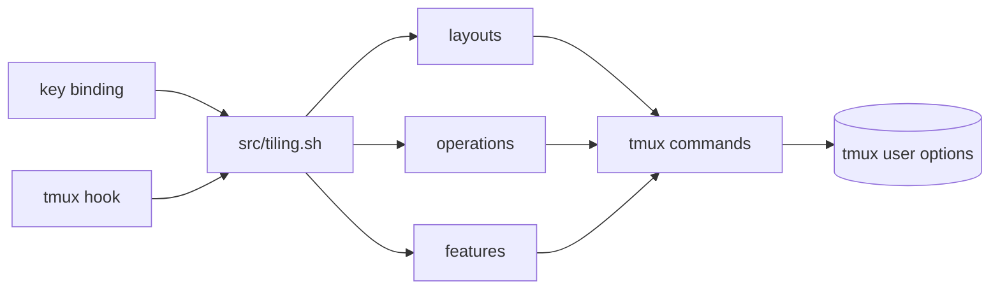

<div align="center">

# tmux-tiling-revamped

<strong>Tiling window management for tmux: eight layouts including BSP dwindle and spiral, with layout undo.</strong>

English &nbsp;|&nbsp; [日本語](README.ja.md) &nbsp;|&nbsp; [简体中文](README.zh-Hans.md) &nbsp;|&nbsp; [繁體中文（香港）](README.zh-HK.md)

[](https://github.com/tmux-revamped/tmux-tiling-revamped/actions/workflows/tests.yml)
[](LICENSE)
[](CHANGELOG.md)

<p align="center">
  <a href="#what-it-does">What it does</a> &nbsp;|&nbsp;
  <a href="#requirements">Requirements</a> &nbsp;|&nbsp;
  <a href="#installation">Installation</a> &nbsp;|&nbsp;
  <a href="#usage">Usage</a> &nbsp;|&nbsp;
  <a href="#configuration">Configuration</a> &nbsp;|&nbsp;
  <a href="#key-bindings">Key bindings</a> &nbsp;|&nbsp;
  <a href="#how-it-works">How it works</a>
</p>

</div>

**8** layouts. **19** operations. **26** default keys, all `M-` plus an uppercase letter, none of them a stock tmux key. Up to **10** undo steps per window.

---

## What it does

The plugin arranges the panes of a window into a layout and keeps it when panes are added, closed or resized. The BSP layouts compute a tmux layout string in bash and apply it with one `select-layout` call.

| Layout | Arrangement |
|:-------|:------------|
| `dwindle` | binary space partition: each new pane takes half of the remaining space, cascading toward a corner |
| `spiral` | the same partition with the pane order reversed at each depth |
| `grid` | tmux's even `tiled` layout |
| `main-center` | a wide center pane with the other panes split evenly between a left and a right column |
| `main-vertical` | master pane on the left at `@tiling_revamped_master_ratio` percent of the width, stack on the right |
| `main-horizontal` | master pane on top at the same ratio of the height, stack below |
| `monocle` | zooms the focused pane. The same command again unzooms it |
| `deck` | every pane at full height, side by side at equal widths |

Beyond layouts it has pane operations such as promote, rotate, flip, circulate and swap, named pane marks, scratchpad popups, saved presets, i3-style workspaces, an fzf layout picker, a pane jumper across sessions, focus history, and per-window undo and redo.

## Requirements

| Tool | Version | Notes |
|:-----|:--------|:------|
| tmux | 3.2 or later | Older tmux shows a message at load and binds nothing |
| bash | 4.0 or later | The entry point uses associative arrays. On the macOS `/bin/bash` 3.2 it shows a message and binds nothing, so install a newer bash with `brew install bash` |
| fzf | optional | Layout picker, pane jumper, swap picker, project launcher, and picking a mark or preset without a name. fzf 0.53.0 or later opens with `--tmux`. An older fzf runs inside `display-popup` |
| fd | optional | Faster project search. Without it the launcher uses `find` |

CI runs the test suite on Ubuntu LTS for x86_64 and arm64 with GNU and uutils coreutils, and on macOS for Apple Silicon and Intel with the system tools, GNU tools and uutils.

## Installation

With [TPM](https://github.com/tmux-plugins/tpm), add this line to `~/.tmux.conf` and press `prefix + I`:

```tmux
set -g @plugin 'tmux-revamped/tmux-tiling-revamped'
```

Without TPM, clone the repository and run the entry point from your config:

```bash
git clone https://github.com/tmux-revamped/tmux-tiling-revamped ~/.tmux/plugins/tmux-tiling-revamped
```

```tmux
run-shell ~/.tmux/plugins/tmux-tiling-revamped/tmux-tiling-revamped.tmux
```

Open a few panes and press `prefix + M-D`, which is Alt, Shift and `d` after the prefix. The panes rearrange into the dwindle layout, and new panes join it.

## Usage

Every key runs a command of [`src/tiling.sh`](src/tiling.sh). You can call the same commands from a shell, a script or your own bindings:

```bash
~/.tmux/plugins/tmux-tiling-revamped/src/tiling.sh layout dwindle brvc
~/.tmux/plugins/tmux-tiling-revamped/src/tiling.sh rotate 180
~/.tmux/plugins/tmux-tiling-revamped/src/tiling.sh preset save dev
~/.tmux/plugins/tmux-tiling-revamped/src/tiling.sh help
```

| Group | Commands |
|:------|:---------|
| Layouts | `layout dwindle [flags]`, `layout spiral [flags]`, `layout grid`, `layout main-center`, `layout main-vertical`, `layout main-horizontal`, `layout monocle`, `layout deck` |
| Operations | `balance`, `equalize`, `rotate [90,180,270]`, `flip [h,v]`, `promote`, `circulate [next,prev]`, `autosplit`, `focus-resize`, `resize-master [grow,shrink]`, `sync`, `swap [U,D,L,R]`, `swap-pick`, `swap-biggest`, `pick`, `cycle [next,prev]`, `undo`, `redo`, `smart-borders`, `pane-jump` |
| Features | `mark <name>`, `unmark [name]`, `jump [name]`, `scratchpad [name] [command]`, `preset save <name>`, `preset apply [name]`, `workspace <N>`, `move-to-workspace <N>`, `back-and-forth`, `project`, `focus-back`, `focus-forward` |
| Automation | `dynamic-layout`, `app-rules`, `focus-record` |
| Diagnostics | `info`, `status`, `help-overlay`, `doctor`, `validate [fix]`, `restore-layouts`, `help` |

### BSP orientation

`dwindle` and `spiral` take a four-letter flag string, 16 combinations in all. The default is `brvc`.

| Position | Values | Meaning |
|:---------|:-------|:--------|
| 1 | `t`, `b` | cascade toward the top or the bottom |
| 2 | `l`, `r` | cascade toward the left or the right |
| 3 | `h`, `v` | first split horizontal or vertical |
| 4 | `c`, `s` | corner, which is dwindle, or spiral |

`@tiling_revamped_split_ratio` sets the first split, from 20 to 80 percent, which helps on ultrawide screens.

### Automatic layouts

With `@tiling_revamped_auto_apply` at its default of `1`, the split, kill, exit and resize hooks reapply the window's layout. `@tiling_revamped_enabled`, set with `set -w`, turns that on or off for one window.

`@tiling_revamped_dynamic_layout` picks the layout from the pane count. With `1:monocle 2:main-vertical 3:dwindle 5:grid`, a window with four panes uses dwindle.

`@tiling_revamped_app_rules` holds newline-separated `pattern:action` rules matched as globs against a new pane's command. The first match wins. `master` promotes the pane, and `float` and `scratchpad` tag it with a pane option.

### Status line

The active layout name is in the `@tiling_revamped_layout` window option:

```tmux
set -g status-right '#{@tiling_revamped_layout} | %H:%M'
```

`src/tiling.sh status` prints the name with a glyph for each of the eight layouts.

### Workspaces and navigation

These need both options below set to `1`, because they bind root-table Alt keys:

```tmux
set -g @tiling_revamped_alt_keys '1'
set -g @tiling_revamped_workspaces '1'
```

`M-1` to `M-9` switch to that window number and create it when missing, and `M-0` goes to window 10. Alt with the shifted digit moves the pane to that window. `@tiling_revamped_shiftnum` lists the shifted characters for your keyboard layout, `!@#$%^&*()` by default. `M-Tab` returns to the previous window.

`@tiling_revamped_navigator '1'` binds `M-h`, `M-j`, `M-k` and `M-l` in the root table to move between panes, and passes the key through when the pane runs vim, neovim or fzf.

## Configuration

| Option | Default | Meaning |
|:-------|:--------|:--------|
| `@tiling_revamped_auto_apply` | `1` | reapply the layout when panes are added, removed or resized |
| `@tiling_revamped_enabled` | empty | window option. `1` reapplies in that window, any other value does not |
| `@tiling_revamped_dynamic_layout` | empty | space-separated `count:layout` pairs |
| `@tiling_revamped_app_rules` | empty | newline-separated `pattern:action` rules |
| `@tiling_revamped_default_layout` | empty | layout applied to every new window |
| `@tiling_revamped_default_orientation` | `brvc` | BSP flags when a window has none |
| `@tiling_revamped_split_ratio` | `50` | first BSP split, 20 to 80 |
| `@tiling_revamped_master_ratio` | `60` | master size for main-vertical and main-horizontal, 20 to 90 |
| `@tiling_revamped_main_center_ratio` | `60` | center width for main-center, 20 to 90 |
| `@tiling_revamped_resize_step` | `5` | percent per grow or shrink of the master |
| `@tiling_revamped_focus_resize` | `0` | `1` grows the focused pane on focus |
| `@tiling_revamped_focus_ratio` | `62` | size of the focused pane in percent |
| `@tiling_revamped_focus_history` | `0` | `1` records focus for the back and forward keys |
| `@tiling_revamped_focus_max` | `20` | history entries per window, 2 to 500 |
| `@tiling_revamped_cycle_layouts` | `dwindle spiral grid main-vertical main-horizontal main-center monocle deck` | cycle order |
| `@tiling_revamped_alt_keys` | `0` | `1` binds keys in the root table with Alt instead of after the prefix |
| `@tiling_revamped_navigator` | `0` | `1` binds vim-aware `M-h`, `M-j`, `M-k`, `M-l` |
| `@tiling_revamped_workspaces` | `0` | `1` binds the workspace keys, together with `@tiling_revamped_alt_keys` |
| `@tiling_revamped_shiftnum` | `!@#$%^&*()` | characters on Shift plus 1 to 0 |
| `@tiling_revamped_project_dir` | empty | root of the project launcher |
| `@tiling_revamped_project_depth` | `1` | directory depth searched for projects |
| `@tiling_revamped_scratch_width` | `80%` | scratchpad popup width |
| `@tiling_revamped_scratch_height` | `75%` | scratchpad popup height |
| `@tiling_revamped_pick_width` | `60%` | layout picker width |
| `@tiling_revamped_pick_height` | `40%` | layout picker height |
| `@tiling_revamped_pick_preview_width` | `60%` | layout picker preview width |
| `@tiling_revamped_jump_width` | `70%` | pane jumper width |
| `@tiling_revamped_jump_height` | `60%` | pane jumper height |
| `@tiling_revamped_jump_preview_width` | `60%` | pane jumper preview width |
| `@tiling_revamped_help_width` | `50%` | help overlay width |
| `@tiling_revamped_help_height` | `60%` | help overlay height |
| `@tiling_revamped_smart_borders` | `0` | `1` hides pane borders while a window has one pane |
| `@tiling_revamped_border_status` | `top` | `pane-border-status` restored when a second pane appears |
| `@tiling_revamped_warn_conflicts` | `1` | `0` silences the key-conflict message at load |
| `@tiling_revamped_enable_logging` | `0` | `1` writes errors to `~/.tmux/tiling-revamped-logs/tiling-revamped.log` |

### Internal state

The plugin manages these options itself. Do not set them, except presets, which you may write by hand in the same format.

| Option | Scope | Holds |
|:-------|:------|:------|
| `@tiling_revamped_layout` | window | current layout name |
| `@tiling_revamped_orientation` | window | BSP flags |
| `@tiling_revamped_layout_history` | window | undo stack, at most 10 entries |
| `@tiling_revamped_layout_redo` | window | redo stack |
| `@tiling_revamped_monocle_prev_layout` | window | layout restored when monocle turns off |
| `@tiling_revamped_applying` | window | the second a layout started applying, so hooks skip re-tiling. Ignored after 10 seconds |
| `@tiling_revamped_focus_stack` | window | focused pane ids, oldest first |
| `@tiling_revamped_focus_pos` | window | cursor into the focus stack |
| `@tiling_revamped_focus_nav` | window | `1` while a back or forward move runs, so it is not recorded |
| `@tiling_revamped_mark` | pane | the pane's mark name |
| `@tiling_revamped_float` | pane | `1` on a pane an app rule tagged `float` |
| `@tiling_revamped_scratchpad` | pane | `1` on a pane an app rule tagged `scratchpad` |
| `@tiling_revamped_marks` | global | every `name:pane` mark |
| `@tiling_revamped_last_window` | global | the window last left, for `M-Tab` |
| `@tiling_revamped_bindings` | global | each feature and the key it holds after conflict resolution |
| `@tiling_revamped_conflicts` | global | every key conflict resolved at load |
| `@tiling_revamped_preset_<name>` | global | a preset as `layout:flags:ratio`, such as `dwindle:brvc:60` |

## Key bindings

Every default is `prefix` followed by `M-` and an uppercase letter, a range stock tmux leaves unbound and the tmux-revamped family reserves for this plugin. Each key has a `@tiling_revamped_key_<action>` option. An empty string unbinds it.

| Key | Action | Option |
|:----|:-------|:-------|
| `M-A` | split along the longer axis | `@tiling_revamped_key_autotile` |
| `M-B` | balance panes within the layout | `@tiling_revamped_key_balance` |
| `M-C` | circulate panes | `@tiling_revamped_key_circulate` |
| `M-D` | dwindle layout | `@tiling_revamped_key_dwindle` |
| `M-E` | equalize panes | `@tiling_revamped_key_equalize` |
| `M-F` | flip the layout | `@tiling_revamped_key_flip` |
| `M-G` | grow the master pane | `@tiling_revamped_key_master_grow` |
| `M-H` | main-horizontal layout | `@tiling_revamped_key_main_horizontal` |
| `M-I` | help overlay | `@tiling_revamped_key_help` |
| `M-J` | jump to a marked pane | `@tiling_revamped_key_jump` |
| `M-K` | mark the pane, prompting for a name | `@tiling_revamped_key_mark` |
| `M-L` | layout picker | `@tiling_revamped_key_pick_layout` |
| `M-M` | promote the pane to master | `@tiling_revamped_key_promote` |
| `M-N` | focus forward in history | `@tiling_revamped_key_focus_forward` |
| `M-O` | cycle layouts | `@tiling_revamped_key_cycle` |
| `M-P` | focus back in history | `@tiling_revamped_key_focus_back` |
| `M-Q` | jump to any pane in any session | `@tiling_revamped_key_pane_jump` |
| `M-R` | rotate the layout | `@tiling_revamped_key_rotate` |
| `M-S` | spiral layout | `@tiling_revamped_key_spiral` |
| `M-T` | scratchpad popup | `@tiling_revamped_key_scratchpad` |
| `M-U` | undo the last layout change | `@tiling_revamped_key_undo` |
| `M-V` | main-vertical layout | `@tiling_revamped_key_main_vertical` |
| `M-W` | swap with the largest pane | `@tiling_revamped_key_swap_biggest` |
| `M-X` | shrink the master pane | `@tiling_revamped_key_master_shrink` |
| `M-Y` | toggle synchronized panes | `@tiling_revamped_key_sync` |
| `M-Z` | redo | `@tiling_revamped_key_redo` |

Unbound by default: the directional swaps `@tiling_revamped_key_swap_up`, `@tiling_revamped_key_swap_down`, `@tiling_revamped_key_swap_left` and `@tiling_revamped_key_swap_right`, the project launcher `@tiling_revamped_key_project`, which also needs `@tiling_revamped_project_dir`, and `@tiling_revamped_key_pick_layout_alt`, which binds Alt plus that key in the root table to the layout picker and passes it through inside vim or fzf. `@tiling_revamped_key_back_and_forth` is `Tab` and takes effect only in workspace mode, as `M-Tab`.

Before 3.0.0 the defaults were plain keys such as `d` for dwindle, many of them stock tmux keys. [`CHANGELOG.md`](CHANGELOG.md) maps every old key to its new one. To keep an old key, set its option:

```tmux
set -g @tiling_revamped_key_dwindle 'd'
```

When two actions resolve to the same key, a key you set beats a default, the losing action stays unbound, and the plugin reports the conflict at load and stores it in `@tiling_revamped_conflicts`. With `@tiling_revamped_alt_keys '1'`, a key that starts with `M-` binds as itself in the root table, so the defaults work without the prefix, and a plain key such as `d` binds as `M-d`.

`M-I` opens a popup listing the layout, pane, mark, scratchpad, undo, pane jumper and focus-history keys with the key each one holds after conflict resolution.

## How it works



[`tmux-tiling-revamped.tmux`](tmux-tiling-revamped.tmux) checks the bash and tmux versions, collects every key binding into a registry, resolves conflicts, writes the bindings, and installs hooks for the options that need them. State lives in tmux user options at window, pane and global scope, with no temp files.

A BSP layout is applied in three steps:

1. `_bsp_build` divides the window into a binary tree. The flags choose each split direction and `@tiling_revamped_split_ratio` sets the first one. The result is a tmux layout string such as `200x50,0,0{100x50,0,0,0,100x50,101,0[...]}`.
2. `_layout_checksum` computes the 16-bit checksum tmux expects in front of a custom layout.
3. One `select-layout` call places every pane. For spiral, `_bsp_fix_pane_order` then swaps panes into their spiral positions.

Hooks pass the window they fired for, and a hook for a background window does not re-tile the window you are looking at. While a layout is being applied, `@tiling_revamped_applying` stops the hooks from re-tiling it again.

`doctor` checks the environment. `info` prints the window's layout state. `validate` fails when a window with one pane still records a layout, and `validate fix` clears it. `restore-layouts` reapplies the layout stored in each window of every session, for use after tmux-resurrect brings the sessions back.

## Development

| Command | What it runs |
|:--------|:-------------|
| `make test` | the bats suite, unit and integration |
| `make test-unit` | the unit tests under [`test/lib`](test/lib) |
| `make lint` | shellcheck at warning level on every shell file |
| `make coverage` | kcov line coverage with a 95 percent floor, Linux only |
| [`family/bin/audit`](family/bin/audit) | this repository against the family contract |

[`test/docs.bats`](test/docs.bats) fails when this README names an option the code does not read. Contribution notes are in [`CONTRIBUTING.md`](CONTRIBUTING.md).

## License

[MIT](LICENSE)

<!-- family:begin -->

## The tmux-revamped family

This plugin is one member of the tmux-revamped family. Every member carries the
same contract in [`FAMILY.md`](FAMILY.md), the same tooling under `family/`, and
the same shared library, all held byte-identical by a checksum manifest. They are
built to be installed together: no member claims a key or a tmux option that
another member claims.

A defect found in one member is hunted across all of them before the fix is
called done. That obligation is written into the contract rather than left to
memory, and `family/bin/sweep` is how it is discharged.

| Member | What it does |
|---|---|
| [`tmux-autoreload-revamped`](https://github.com/tmux-revamped/tmux-autoreload-revamped) | Edit your tmux config, save, and watch it reload itself, no key, no command |
| [`tmux-battery-revamped`](https://github.com/tmux-revamped/tmux-battery-revamped) | Battery status for your tmux status bar, without ever blocking the status render |
| [`tmux-bluetooth-revamped`](https://github.com/tmux-revamped/tmux-bluetooth-revamped) | Every connected Bluetooth device and its battery in your tmux status bar, without blocking the render |
| [`tmux-cpu-revamped`](https://github.com/tmux-revamped/tmux-cpu-revamped) | CPU load, temperature, and frequency in your tmux status bar, without ever blocking the render |
| [`tmux-disk-revamped`](https://github.com/tmux-revamped/tmux-disk-revamped) | Disk usage for your tmux status bar, without ever blocking the status render |
| [`tmux-extract-revamped`](https://github.com/tmux-revamped/tmux-extract-revamped) | Pick a URL, path, hash or any other token off the screen with fzf and type it at the cursor, in pure shell |
| [`tmux-fzf-revamped`](https://github.com/tmux-revamped/tmux-fzf-revamped) | Switch to, kill, rename or create tmux sessions, windows and panes from fzf pickers in a popup |
| [`tmux-git-revamped`](https://github.com/tmux-revamped/tmux-git-revamped) | Show the active pane's git branch, changes and provider counts in the tmux status bar without blocking it |
| [`tmux-gpu-revamped`](https://github.com/tmux-revamped/tmux-gpu-revamped) | GPU load, temperature, clock, power and memory in the tmux status bar, from NVIDIA, AMD, Intel and Apple GPUs |
| [`tmux-kube-revamped`](https://github.com/tmux-revamped/tmux-kube-revamped) | Current Kubernetes context and namespace in the tmux status bar, parsed from kubeconfig without kubectl |
| [`tmux-launcher-revamped`](https://github.com/tmux-revamped/tmux-launcher-revamped) | Launch any TUI app in a popup or a window, scoped to the current pane's directory, with one configurable bindi |
| [`tmux-logging-revamped`](https://github.com/tmux-revamped/tmux-logging-revamped) | Capture any pane to a file: live logging, full scrollback, or a one-shot screenshot |
| [`tmux-music-revamped`](https://github.com/tmux-revamped/tmux-music-revamped) | Now playing in your tmux status bar, without ever blocking the status render |
| [`tmux-network-revamped`](https://github.com/tmux-revamped/tmux-network-revamped) | Network throughput in your tmux status bar, without ever blocking the render |
| [`tmux-pain-control-revamped`](https://github.com/tmux-revamped/tmux-pain-control-revamped) | Standard pane and window management bindings for tmux, version aware, vim friendly, and fully configurable |
| [`tmux-persist-revamped`](https://github.com/tmux-revamped/tmux-persist-revamped) | Save every tmux session, window and pane, auto-save on a timer, and restore it all after a reboot |
| [`tmux-plugin-template`](https://github.com/tmux-revamped/tmux-plugin-template) | The starting point for a tmux-revamped plugin: shared library, bats harness, CI and family tooling |
| [`tmux-pomodoro-revamped`](https://github.com/tmux-revamped/tmux-pomodoro-revamped) | A Pomodoro timer in the tmux status bar that keeps all of its state in tmux options, with no temp files |
| [`tmux-ram-revamped`](https://github.com/tmux-revamped/tmux-ram-revamped) | RAM, swap and memory pressure in the tmux status bar, sampled in the background so the render never waits |
| [`tmux-reorder-revamped`](https://github.com/tmux-revamped/tmux-reorder-revamped) | Drag a window tab along the tmux status bar with the mouse to move that window |
| [`tmux-scroll-revamped`](https://github.com/tmux-revamped/tmux-scroll-revamped) | Send the mouse wheel to apps that scroll themselves and into tmux copy-mode everywhere else |
| [`tmux-sensible-revamped`](https://github.com/tmux-revamped/tmux-sensible-revamped) | Sensible tmux defaults, gated by tmux version and terminal, that leave the options you set alone |
| [`tmux-tiling-revamped`](https://github.com/tmux-revamped/tmux-tiling-revamped) | **this plugin**, Tiling window management for tmux: eight layouts including BSP dwindle and spiral, with layout undo |
| [`tmux-time-revamped`](https://github.com/tmux-revamped/tmux-time-revamped) | Local and world clocks for the tmux status bar, colored by time of day, with countdowns and a DST warning |
| [`tmux-weather-revamped`](https://github.com/tmux-revamped/tmux-weather-revamped) | Weather for the tmux status bar from wttr.in, fetched in the background so the status line never waits |

### Checking an installation

With every member on disk, one command reports any conflict between them:

```sh
family/bin/doctor --live
```

It reads each member and the running tmux server, and reports duplicate keys,
duplicate status placeholders, options outside the naming grammar, and any
member whose contract version has fallen behind.

<!-- family:end -->
