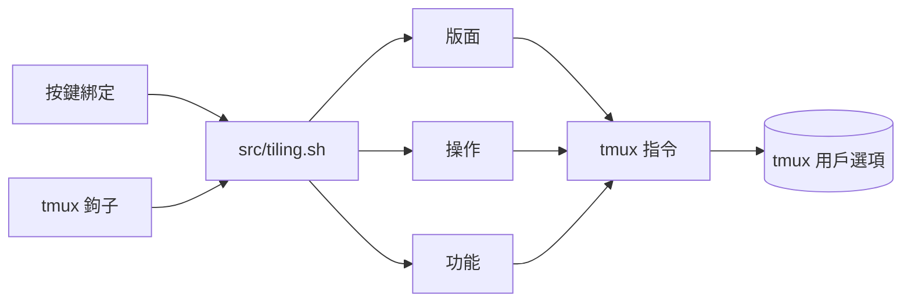

<div align="center">

# tmux-tiling-revamped

<strong>tmux 的平鋪視窗管理：八種版面，包括 BSP dwindle 和 spiral，並支援復原版面。</strong>

[English](README.md) &nbsp;|&nbsp; [日本語](README.ja.md) &nbsp;|&nbsp; [简体中文](README.zh-Hans.md) &nbsp;|&nbsp; 繁體中文（香港）

[](https://github.com/tmux-revamped/tmux-tiling-revamped/actions/workflows/family.yml)
[](https://github.com/tmux-revamped/tmux-tiling-revamped/actions/workflows/tests.yml)
[](https://github.com/tmux-revamped/tmux-tiling-revamped/actions/workflows/tiling-checks.yml)
[](https://github.com/tmux-revamped/tmux-tiling-revamped/releases/latest)
[](https://scorecard.dev/viewer/?uri=github.com/tmux-revamped/tmux-tiling-revamped)
[](LICENSE)

<p align="center">
  <a href="#功能">功能</a> &nbsp;|&nbsp;
  <a href="#系統要求">系統要求</a> &nbsp;|&nbsp;
  <a href="#安裝">安裝</a> &nbsp;|&nbsp;
  <a href="#用法">用法</a> &nbsp;|&nbsp;
  <a href="#設定">設定</a> &nbsp;|&nbsp;
  <a href="#快捷鍵">快捷鍵</a> &nbsp;|&nbsp;
  <a href="#運作原理">運作原理</a>
</p>

</div>

**8** 種版面。**19** 個操作。**26** 個預設按鍵，全部是 `M-` 加大寫字母，沒有一個是 tmux 內置的按鍵。每個視窗最多 **10** 步復原。

---

## 功能

本插件把視窗中的窗格按版面排列，並在加入、關閉窗格或調整大小後保持該版面。BSP 版面在 bash 中計算出 tmux 版面字串，並以一次 `select-layout` 呼叫套用。

| 版面 | 排列方式 |
|:-------|:------------|
| `dwindle` | 二元空間分割：每個新窗格佔餘下空間的一半，朝一個角逐層分割 |
| `spiral` | 同樣的分割，但在每一層倒轉窗格次序 |
| `grid` | tmux 內置的平均 `tiled` 版面 |
| `main-center` | 一個寬闊的中央窗格，其餘窗格平均分到左右兩欄 |
| `main-vertical` | 主窗格在左方，佔寬度的 `@tiling_revamped_master_ratio` 百分比，其餘窗格在右方堆疊 |
| `main-horizontal` | 主窗格在上方，按同樣比例佔高度，其餘窗格在下方堆疊 |
| `monocle` | 放大目前窗格。再次執行同一指令便還原 |
| `deck` | 所有窗格佔滿高度，以相同寬度並排 |

除版面外，還有 promote、rotate、flip、circulate 和 swap 等窗格操作，命名的窗格標記、草稿板彈出視窗、儲存的預設組合、i3 風格的工作區、fzf 版面選擇器、跨工作階段的窗格跳轉、焦點記錄，以及按視窗的復原和重做。

## 系統要求

| 工具 | 版本 | 備註 |
|:-----|:--------|:------|
| tmux | 3.2 或以上 | 較舊的 tmux 會在載入時顯示訊息，並且不綁定任何按鍵 |
| bash | 4.0 或以上 | 入口腳本使用關聯陣列。在 macOS 的 `/bin/bash` 3.2 上會顯示訊息而不綁定任何按鍵，請用 `brew install bash` 安裝較新的 bash |
| fzf | 可選 | 用於版面選擇器、窗格跳轉、交換選擇器、項目啟動器，以及不附名稱時選擇標記或預設組合。fzf 0.53.0 或以後以 `--tmux` 開啟，較舊的 fzf 在 `display-popup` 中執行 |
| fd | 可選 | 加快項目搜尋。沒有時啟動器使用 `find` |

CI 在 Ubuntu LTS 的 x86_64 和 arm64 上使用 GNU 和 uutils coreutils 執行測試，在 macOS 的 Apple Silicon 和 Intel 上使用系統工具、GNU 工具和 uutils 執行測試。

## 安裝

使用 [TPM](https://github.com/tmux-plugins/tpm) 時，把以下這行加入 `~/.tmux.conf`，然後按 `prefix + I`：

```tmux
set -g @plugin 'tmux-revamped/tmux-tiling-revamped'
```

不使用 TPM 時，複製儲存庫並在設定中執行入口腳本：

```bash
git clone https://github.com/tmux-revamped/tmux-tiling-revamped ~/.tmux/plugins/tmux-tiling-revamped
```

```tmux
run-shell ~/.tmux/plugins/tmux-tiling-revamped/tmux-tiling-revamped.tmux
```

開啟幾個窗格並按 `prefix + M-D`，即在前綴鍵之後按 Alt、Shift 和 `d`。窗格會重新排列成 dwindle 版面，新窗格亦會加入其中。

## 用法

每個按鍵都執行 [`src/tiling.sh`](src/tiling.sh) 的一條指令。你可以從 shell、腳本或自己的綁定中呼叫同樣的指令：

```bash
~/.tmux/plugins/tmux-tiling-revamped/src/tiling.sh layout dwindle brvc
~/.tmux/plugins/tmux-tiling-revamped/src/tiling.sh rotate 180
~/.tmux/plugins/tmux-tiling-revamped/src/tiling.sh preset save dev
~/.tmux/plugins/tmux-tiling-revamped/src/tiling.sh help
```

| 分組 | 指令 |
|:------|:---------|
| 版面 | `layout dwindle [flags]`、`layout spiral [flags]`、`layout grid`、`layout main-center`、`layout main-vertical`、`layout main-horizontal`、`layout monocle`、`layout deck` |
| 操作 | `balance`、`equalize`、`rotate [90,180,270]`、`flip [h,v]`、`promote`、`circulate [next,prev]`、`autosplit`、`focus-resize`、`resize-master [grow,shrink]`、`sync`、`swap [U,D,L,R]`、`swap-pick`、`swap-biggest`、`pick`、`cycle [next,prev]`、`undo`、`redo`、`smart-borders`、`pane-jump` |
| 功能 | `mark <name>`、`unmark [name]`、`jump [name]`、`scratchpad [name] [command]`、`preset save <name>`、`preset apply [name]`、`workspace <N>`、`move-to-workspace <N>`、`back-and-forth`、`project`、`focus-back`、`focus-forward` |
| 自動化 | `dynamic-layout`、`app-rules`、`focus-record` |
| 診斷 | `info`、`status`、`help-overlay`、`doctor`、`validate [fix]`、`restore-layouts`、`help` |

### BSP 方向

`dwindle` 和 `spiral` 接受一個四字母的旗標字串，共 16 種組合。預設為 `brvc`。

| 位置 | 取值 | 意思 |
|:---------|:-------|:--------|
| 1 | `t`、`b` | 朝上方或下方分割 |
| 2 | `l`、`r` | 朝左方或右方分割 |
| 3 | `h`、`v` | 第一次分割為水平或垂直 |
| 4 | `c`、`s` | 角落，即 dwindle，或 spiral |

`@tiling_revamped_split_ratio` 設定第一次分割，範圍為 20 至 80 百分比，適合超闊螢幕。

### 自動版面

當 `@tiling_revamped_auto_apply` 為預設的 `1` 時，分割、關閉、結束和調整大小的鉤子會重新套用視窗的版面。以 `set -w` 設定的 `@tiling_revamped_enabled` 可為單一視窗開啟或關閉這行為。

`@tiling_revamped_dynamic_layout` 按窗格數目選擇版面。設為 `1:monocle 2:main-vertical 3:dwindle 5:grid` 時，有四個窗格的視窗使用 dwindle。

`@tiling_revamped_app_rules` 保存以換行分隔的 `pattern:action` 規則，以 glob 方式與新窗格的指令比對，第一條相符的規則生效。`master` 把該窗格提升為主窗格，`float` 和 `scratchpad` 以窗格選項為它加上標記。

### 狀態列

目前版面名稱存放在視窗選項 `@tiling_revamped_layout` 中：

```tmux
set -g status-right '#{@tiling_revamped_layout} | %H:%M'
```

`src/tiling.sh status` 會為八種版面分別加上圖示後列印名稱。

### 工作區與導航

它們會在根鍵表中綁定 Alt 按鍵，因此需要把以下兩個選項都設為 `1`：

```tmux
set -g @tiling_revamped_alt_keys '1'
set -g @tiling_revamped_workspaces '1'
```

`M-1` 至 `M-9` 切換到該編號的視窗，不存在時便建立，`M-0` 切換到視窗 10。Alt 加上按住 Shift 的數字，會把窗格移到該視窗。`@tiling_revamped_shiftnum` 列出你的鍵盤配置下按 Shift 得到的字符，預設為 `!@#$%^&*()`。`M-Tab` 返回上一個視窗。

`@tiling_revamped_navigator '1'` 在根鍵表中綁定 `M-h`、`M-j`、`M-k` 和 `M-l` 以在窗格之間移動，當窗格中執行 vim、neovim 或 fzf 時把按鍵原樣傳入。

## 設定

| 選項 | 預設值 | 意思 |
|:-------|:--------|:--------|
| `@tiling_revamped_auto_apply` | `1` | 加入、移除窗格或調整大小時重新套用版面 |
| `@tiling_revamped_enabled` | 空 | 視窗選項。`1` 表示在該視窗重新套用，其他值則不套用 |
| `@tiling_revamped_dynamic_layout` | 空 | 以空格分隔的 `count:layout` 組合 |
| `@tiling_revamped_app_rules` | 空 | 以換行分隔的 `pattern:action` 規則 |
| `@tiling_revamped_default_layout` | 空 | 套用於每個新視窗的版面 |
| `@tiling_revamped_default_orientation` | `brvc` | 視窗沒有旗標時使用的 BSP 旗標 |
| `@tiling_revamped_split_ratio` | `50` | BSP 第一次分割，20 至 80 |
| `@tiling_revamped_master_ratio` | `60` | main-vertical 和 main-horizontal 的主窗格大小，20 至 90 |
| `@tiling_revamped_main_center_ratio` | `60` | main-center 的中央寬度，20 至 90 |
| `@tiling_revamped_resize_step` | `5` | 每次放大或縮小主窗格的百分比 |
| `@tiling_revamped_focus_resize` | `0` | 設為 `1` 時放大取得焦點的窗格 |
| `@tiling_revamped_focus_ratio` | `62` | 取得焦點的窗格大小，百分比 |
| `@tiling_revamped_focus_history` | `0` | 設為 `1` 時為後退和前進按鍵記錄焦點 |
| `@tiling_revamped_focus_max` | `20` | 每個視窗的記錄數目，2 至 500 |
| `@tiling_revamped_cycle_layouts` | `dwindle spiral grid main-vertical main-horizontal main-center monocle deck` | 循環次序 |
| `@tiling_revamped_alt_keys` | `0` | 設為 `1` 時在根鍵表中以 Alt 綁定按鍵，而不是放在前綴鍵之後 |
| `@tiling_revamped_navigator` | `0` | 設為 `1` 時綁定會識別 vim 的 `M-h`、`M-j`、`M-k`、`M-l` |
| `@tiling_revamped_workspaces` | `0` | 設為 `1` 時與 `@tiling_revamped_alt_keys` 一同綁定工作區按鍵 |
| `@tiling_revamped_shiftnum` | `!@#$%^&*()` | Shift 加 1 至 0 得到的字符 |
| `@tiling_revamped_project_dir` | 空 | 項目啟動器的根目錄 |
| `@tiling_revamped_project_depth` | `1` | 搜尋項目的目錄深度 |
| `@tiling_revamped_scratch_width` | `80%` | 草稿板彈出視窗寬度 |
| `@tiling_revamped_scratch_height` | `75%` | 草稿板彈出視窗高度 |
| `@tiling_revamped_pick_width` | `60%` | 版面選擇器寬度 |
| `@tiling_revamped_pick_height` | `40%` | 版面選擇器高度 |
| `@tiling_revamped_pick_preview_width` | `60%` | 版面選擇器預覽寬度 |
| `@tiling_revamped_jump_width` | `70%` | 窗格跳轉寬度 |
| `@tiling_revamped_jump_height` | `60%` | 窗格跳轉高度 |
| `@tiling_revamped_jump_preview_width` | `60%` | 窗格跳轉預覽寬度 |
| `@tiling_revamped_help_width` | `50%` | 說明浮層寬度 |
| `@tiling_revamped_help_height` | `60%` | 說明浮層高度 |
| `@tiling_revamped_smart_borders` | `0` | 設為 `1` 時在視窗只有一個窗格期間隱藏窗格邊框 |
| `@tiling_revamped_border_status` | `top` | 出現第二個窗格時還原的 `pane-border-status` |
| `@tiling_revamped_warn_conflicts` | `1` | 設為 `0` 時載入時不顯示按鍵衝突訊息 |
| `@tiling_revamped_enable_logging` | `0` | 設為 `1` 時把錯誤寫入 `~/.tmux/tiling-revamped-logs/tiling-revamped.log` |

### 內部狀態

這些選項由插件自行管理，請勿設定。預設組合除外，你可以按同樣格式親手編寫。

| 選項 | 範圍 | 保存內容 |
|:-------|:------|:------|
| `@tiling_revamped_layout` | window | 目前版面名稱 |
| `@tiling_revamped_orientation` | window | BSP 旗標 |
| `@tiling_revamped_layout_history` | window | 復原堆疊，最多 10 項 |
| `@tiling_revamped_layout_redo` | window | 重做堆疊 |
| `@tiling_revamped_monocle_prev_layout` | window | 關閉 monocle 時還原的版面 |
| `@tiling_revamped_applying` | window | 開始套用版面時的秒數，鉤子據此略過重新平鋪。超過 10 秒後忽略 |
| `@tiling_revamped_focus_stack` | window | 取得過焦點的窗格 ID，由舊至新 |
| `@tiling_revamped_focus_pos` | window | 焦點堆疊中的游標 |
| `@tiling_revamped_focus_nav` | window | 後退或前進移動進行中時為 `1`，該移動不會被記錄 |
| `@tiling_revamped_mark` | pane | 窗格的標記名稱 |
| `@tiling_revamped_float` | pane | 被應用程式規則標記為 `float` 的窗格上為 `1` |
| `@tiling_revamped_scratchpad` | pane | 被應用程式規則標記為 `scratchpad` 的窗格上為 `1` |
| `@tiling_revamped_marks` | global | 所有 `name:pane` 標記 |
| `@tiling_revamped_last_window` | global | 最近離開的視窗，供 `M-Tab` 使用 |
| `@tiling_revamped_bindings` | global | 每項功能及其在衝突解決後持有的按鍵 |
| `@tiling_revamped_conflicts` | global | 載入時解決的所有按鍵衝突 |
| `@tiling_revamped_preset_<name>` | global | 以 `layout:flags:ratio` 儲存的預設組合，例如 `dwindle:brvc:60` |

## 快捷鍵

所有預設按鍵都是 `prefix` 之後按 `M-` 加大寫字母。tmux 本身不綁定這個範圍，tmux-revamped 系列把它留給本插件。每個按鍵都有對應的 `@tiling_revamped_key_<action>` 選項，設為空字串便可解除綁定。

| 按鍵 | 動作 | 選項 |
|:----|:-------|:-------|
| `M-A` | 沿較長的軸分割 | `@tiling_revamped_key_autotile` |
| `M-B` | 在版面內平衡窗格 | `@tiling_revamped_key_balance` |
| `M-C` | 循環窗格 | `@tiling_revamped_key_circulate` |
| `M-D` | dwindle 版面 | `@tiling_revamped_key_dwindle` |
| `M-E` | 平分窗格 | `@tiling_revamped_key_equalize` |
| `M-F` | 翻轉版面 | `@tiling_revamped_key_flip` |
| `M-G` | 放大主窗格 | `@tiling_revamped_key_master_grow` |
| `M-H` | main-horizontal 版面 | `@tiling_revamped_key_main_horizontal` |
| `M-I` | 說明浮層 | `@tiling_revamped_key_help` |
| `M-J` | 跳到已標記的窗格 | `@tiling_revamped_key_jump` |
| `M-K` | 標記窗格，提示輸入名稱 | `@tiling_revamped_key_mark` |
| `M-L` | 版面選擇器 | `@tiling_revamped_key_pick_layout` |
| `M-M` | 把窗格提升為主窗格 | `@tiling_revamped_key_promote` |
| `M-N` | 在記錄中前進焦點 | `@tiling_revamped_key_focus_forward` |
| `M-O` | 循環切換版面 | `@tiling_revamped_key_cycle` |
| `M-P` | 在記錄中後退焦點 | `@tiling_revamped_key_focus_back` |
| `M-Q` | 跳到任何工作階段中的任何窗格 | `@tiling_revamped_key_pane_jump` |
| `M-R` | 旋轉版面 | `@tiling_revamped_key_rotate` |
| `M-S` | spiral 版面 | `@tiling_revamped_key_spiral` |
| `M-T` | 草稿板彈出視窗 | `@tiling_revamped_key_scratchpad` |
| `M-U` | 復原上一次版面變更 | `@tiling_revamped_key_undo` |
| `M-V` | main-vertical 版面 | `@tiling_revamped_key_main_vertical` |
| `M-W` | 與最大的窗格交換 | `@tiling_revamped_key_swap_biggest` |
| `M-X` | 縮小主窗格 | `@tiling_revamped_key_master_shrink` |
| `M-Y` | 切換窗格同步 | `@tiling_revamped_key_sync` |
| `M-Z` | 重做 | `@tiling_revamped_key_redo` |

預設不綁定的有：方向交換 `@tiling_revamped_key_swap_up`、`@tiling_revamped_key_swap_down`、`@tiling_revamped_key_swap_left` 和 `@tiling_revamped_key_swap_right`；項目啟動器 `@tiling_revamped_key_project`，它亦需要 `@tiling_revamped_project_dir`；以及 `@tiling_revamped_key_pick_layout_alt`，它在根鍵表中把 Alt 加該鍵綁定到版面選擇器，在 vim 或 fzf 中則把按鍵原樣傳入。`@tiling_revamped_key_back_and_forth` 為 `Tab`，只在工作區模式下以 `M-Tab` 生效。

3.0.0 之前的預設按鍵是單一按鍵，例如 dwindle 的 `d`，其中不少是 tmux 內置的按鍵。[`CHANGELOG.md`](CHANGELOG.md) 列出每個舊按鍵對應的新按鍵。如要繼續使用舊按鍵，設定對應選項即可：

```tmux
set -g @tiling_revamped_key_dwindle 'd'
```

當兩個動作落在同一個按鍵上時，你設定的按鍵優先於預設按鍵，落敗的動作保持不綁定，插件會在載入時報告衝突並存放到 `@tiling_revamped_conflicts`。當 `@tiling_revamped_alt_keys '1'` 時，以 `M-` 開頭的按鍵按原樣綁定在根鍵表中，因此預設按鍵毋須前綴鍵即可使用，而 `d` 這類單一按鍵會綁定為 `M-d`。

`M-I` 開啟一個彈出視窗，列出版面、窗格、標記、草稿板、復原、窗格跳轉和焦點記錄的按鍵，以及每個按鍵在衝突解決後的實際按鍵。

## 運作原理



[`tmux-tiling-revamped.tmux`](tmux-tiling-revamped.tmux) 檢查 bash 和 tmux 版本，把所有按鍵綁定收集到一個登記表中，解決衝突，寫入綁定，並為需要的選項安裝鉤子。狀態存放在視窗、窗格和全域範圍的 tmux 用戶選項中，不使用暫存檔。

BSP 版面分三步套用：

1. `_bsp_build` 把視窗劃分成一棵二元樹。旗標決定每次分割的方向，`@tiling_revamped_split_ratio` 決定第一次分割。結果是一個 tmux 版面字串，例如 `200x50,0,0{100x50,0,0,0,100x50,101,0[...]}`。
2. `_layout_checksum` 計算 tmux 要求放在自訂版面前面的 16 位元校驗和。
3. 一次 `select-layout` 呼叫放置所有窗格。對於 spiral，隨後由 `_bsp_fix_pane_order` 把窗格交換到螺旋位置。

鉤子會傳入觸發它的視窗，因此背景視窗的鉤子不會重新平鋪你正在查看的視窗。在套用版面期間，`@tiling_revamped_applying` 會阻止鉤子再次重新平鋪。

`doctor` 檢查執行環境。`info` 列印視窗的版面狀態。當只有一個窗格的視窗仍記錄著版面時，`validate` 會失敗，`validate fix` 會清除該記錄。`restore-layouts` 在每個工作階段的每個視窗中重新套用已儲存的版面，用於 tmux-resurrect 還原工作階段之後。

## 開發

| 指令 | 執行內容 |
|:--------|:-------------|
| `make test` | bats 測試套件，包括單元測試和整合測試 |
| `make test-unit` | [`test/lib`](test/lib) 下的單元測試 |
| `make lint` | 對所有 shell 檔案執行 warning 級別的 shellcheck |
| `make coverage` | kcov 行覆蓋率，下限 95%，只限 Linux |
| [`family/bin/audit`](family/bin/audit) | 按系列約定檢查本儲存庫 |

當本 README 提到程式碼不讀取的選項時，[`test/docs.bats`](test/docs.bats) 會失敗。貢獻說明見 [`CONTRIBUTING.md`](CONTRIBUTING.md)。

## 授權

[MIT](LICENSE)

<!-- family:begin -->

## tmux-revamped 插件家族

本插件是 tmux-revamped 插件家族的成員。每個成員都帶有 [`FAMILY.md`](FAMILY.md) 中的同一份約定、`family/` 下的同一套工具和同一個共用程式庫，並由校驗和清單確保逐位元組一致。這些成員可以一併安裝：任何成員都不會佔用其他成員使用的按鍵或 tmux 選項。

在一個成員中發現的缺陷，要在全部成員中排查後才算修正完成。這項責任寫在約定之中，而不是依靠記憶，`family/bin/sweep` 負責執行。

| 成員 | 功能 |
|---|---|
| [`tmux-autoreload-revamped`](https://github.com/tmux-revamped/tmux-autoreload-revamped) | 編輯並儲存 tmux 設定後，它會自動重新載入，毋須按鍵，也毋須指令 |
| [`tmux-battery-revamped`](https://github.com/tmux-revamped/tmux-battery-revamped) | 在 tmux 狀態列顯示電池狀態，從不阻塞狀態列繪製 |
| [`tmux-bluetooth-revamped`](https://github.com/tmux-revamped/tmux-bluetooth-revamped) | 在 tmux 狀態列顯示每部已連接的藍牙裝置及其電量，不阻塞繪製 |
| [`tmux-cpu-revamped`](https://github.com/tmux-revamped/tmux-cpu-revamped) | 在 tmux 狀態列顯示 CPU 負載、溫度及頻率，從不阻塞繪製 |
| [`tmux-disk-revamped`](https://github.com/tmux-revamped/tmux-disk-revamped) | 在 tmux 狀態列顯示磁碟用量，從不阻塞狀態列繪製 |
| [`tmux-extract-revamped`](https://github.com/tmux-revamped/tmux-extract-revamped) | 用 fzf 從畫面上揀選 URL、路徑、雜湊值或任何其他字詞，並輸入到游標位置，全部以純 shell 實現 |
| [`tmux-fzf-revamped`](https://github.com/tmux-revamped/tmux-fzf-revamped) | 在彈出視窗的 fzf 選擇器中切換、關閉、重新命名或建立 tmux 工作階段、視窗和窗格 |
| [`tmux-git-revamped`](https://github.com/tmux-revamped/tmux-git-revamped) | 在 tmux 狀態列顯示當前窗格的 git 分支、改動和託管平台數目，而不會阻塞顯示 |
| [`tmux-gpu-revamped`](https://github.com/tmux-revamped/tmux-gpu-revamped) | 在 tmux 狀態列顯示 NVIDIA、AMD、Intel 及 Apple GPU 的負載、溫度、時脈、功耗及記憶體 |
| [`tmux-kube-revamped`](https://github.com/tmux-revamped/tmux-kube-revamped) | 在 tmux 狀態列顯示目前的 Kubernetes 上下文及命名空間，毋須 kubectl，直接解析 kubeconfig |
| [`tmux-launcher-revamped`](https://github.com/tmux-revamped/tmux-launcher-revamped) | 在彈出視窗或新視窗中啟動任何 TUI 應用程式，從目前窗格的目錄開始，每個應用程式可設定一個按鍵 |
| [`tmux-logging-revamped`](https://github.com/tmux-revamped/tmux-logging-revamped) | 將任何窗格儲存到檔案：即時記錄、完整捲動緩衝區或一次性截圖 |
| [`tmux-music-revamped`](https://github.com/tmux-revamped/tmux-music-revamped) | 在 tmux 狀態列顯示正在播放的歌曲，從不阻塞狀態列的繪製 |
| [`tmux-network-revamped`](https://github.com/tmux-revamped/tmux-network-revamped) | 在 tmux 狀態列顯示網絡傳輸量，從不阻塞繪製 |
| [`tmux-pain-control-revamped`](https://github.com/tmux-revamped/tmux-pain-control-revamped) | tmux 的窗格和視窗管理按鍵，配合 tmux 版本，與 vim 相容，每個 prefix 按鍵都可停用 |
| [`tmux-persist-revamped`](https://github.com/tmux-revamped/tmux-persist-revamped) | 儲存 tmux 的所有工作階段、視窗及窗格，按計時器自動儲存，並在重新開機後全部還原 |
| [`tmux-plugin-template`](https://github.com/tmux-revamped/tmux-plugin-template) | tmux-revamped 插件的起點：共用程式庫、bats 測試框架、CI 和系列工具 |
| [`tmux-pomodoro-revamped`](https://github.com/tmux-revamped/tmux-pomodoro-revamped) | tmux 狀態列中的番茄鐘計時器，所有狀態都儲存在 tmux 選項中，不使用暫存檔 |
| [`tmux-ram-revamped`](https://github.com/tmux-revamped/tmux-ram-revamped) | 在 tmux 狀態列顯示記憶體、交換空間及記憶體壓力，在背景取樣，繪製從不等待 |
| [`tmux-reorder-revamped`](https://github.com/tmux-revamped/tmux-reorder-revamped) | 用滑鼠在 tmux 狀態列上拖動視窗標籤來移動該視窗 |
| [`tmux-scroll-revamped`](https://github.com/tmux-revamped/tmux-scroll-revamped) | 將滑鼠滾輪交給能自行捲動的應用程式，其他情況下進入 tmux 複製模式 |
| [`tmux-sensible-revamped`](https://github.com/tmux-revamped/tmux-sensible-revamped) | 按 tmux 版本和終端機區分的合理預設設定，不會改動你自己設定的選項 |
| [`tmux-tiling-revamped`](https://github.com/tmux-revamped/tmux-tiling-revamped) | **本插件**，tmux 的平鋪視窗管理：八種版面，包括 BSP dwindle 和 spiral，並支援復原版面 |
| [`tmux-time-revamped`](https://github.com/tmux-revamped/tmux-time-revamped) | 狀態列中的本地時鐘和世界時鐘，按一天中的時段著色，並提供倒數和夏令時間提示 |
| [`tmux-weather-revamped`](https://github.com/tmux-revamped/tmux-weather-revamped) | 在背景從 wttr.in 取得天氣並顯示在狀態列，狀態列毋須等待 |

### 檢查安裝

所有成員都在磁碟上時，一個指令即可報告它們之間的任何衝突：

```sh
family/bin/doctor --live
```

它讀取每個成員和正在運行的 tmux 伺服器，報告重複的按鍵、重複的狀態佔位符、不符合命名規則的選項，以及約定版本落後的成員。

<!-- family:end -->
