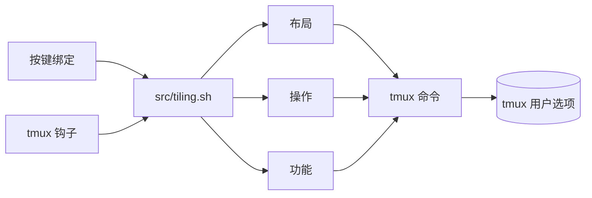

<div align="center">

# tmux-tiling-revamped

<strong>tmux 的平铺窗口管理：八种布局，包括 BSP dwindle 和 spiral，并支持撤销布局。</strong>

[English](README.md) &nbsp;|&nbsp; [日本語](README.ja.md) &nbsp;|&nbsp; 简体中文 &nbsp;|&nbsp; [繁體中文（香港）](README.zh-HK.md)

[](https://github.com/tmux-revamped/tmux-tiling-revamped/actions/workflows/family.yml)
[](https://github.com/tmux-revamped/tmux-tiling-revamped/actions/workflows/tests.yml)
[](https://github.com/tmux-revamped/tmux-tiling-revamped/actions/workflows/tiling-checks.yml)
[](https://github.com/tmux-revamped/tmux-tiling-revamped/releases/latest)
[](https://scorecard.dev/viewer/?uri=github.com/tmux-revamped/tmux-tiling-revamped)
[](LICENSE)

<p align="center">
  <a href="#功能">功能</a> &nbsp;|&nbsp;
  <a href="#环境要求">环境要求</a> &nbsp;|&nbsp;
  <a href="#安装">安装</a> &nbsp;|&nbsp;
  <a href="#用法">用法</a> &nbsp;|&nbsp;
  <a href="#配置">配置</a> &nbsp;|&nbsp;
  <a href="#快捷键">快捷键</a> &nbsp;|&nbsp;
  <a href="#工作原理">工作原理</a>
</p>

</div>

**8** 种布局。**19** 个操作。**26** 个默认按键，全部是 `M-` 加大写字母，没有一个是 tmux 自带的按键。每个窗口最多 **10** 步撤销。

---

## 功能

本插件把窗口中的窗格按布局排列，并在添加、关闭窗格或调整大小后保持该布局。BSP 布局在 bash 中计算出 tmux 布局字符串，并用一次 `select-layout` 调用应用。

| 布局 | 排列方式 |
|:-------|:------------|
| `dwindle` | 二叉空间分割：每个新窗格占剩余空间的一半，朝一个角逐级分割 |
| `spiral` | 同样的分割，但在每一层反转窗格顺序 |
| `grid` | tmux 自带的均匀 `tiled` 布局 |
| `main-center` | 一个宽的中央窗格，其余窗格平均分到左右两列 |
| `main-vertical` | 主窗格在左侧，占宽度的 `@tiling_revamped_master_ratio` 百分比，其余窗格在右侧堆叠 |
| `main-horizontal` | 主窗格在上方，按同样比例占高度，其余窗格在下方堆叠 |
| `monocle` | 放大当前窗格。再次执行同一命令即可还原 |
| `deck` | 所有窗格占满高度，以相同宽度并排 |

除布局外，还有 promote、rotate、flip、circulate 和 swap 等窗格操作，命名的窗格标记、草稿板弹出窗口、保存的预设、i3 风格的工作区、fzf 布局选择器、跨会话的窗格跳转、焦点历史，以及按窗口的撤销和重做。

## 环境要求

| 工具 | 版本 | 说明 |
|:-----|:--------|:------|
| tmux | 3.2 或更高 | 更旧的 tmux 会在加载时显示消息，且不绑定任何按键 |
| bash | 4.0 或更高 | 入口脚本使用关联数组。在 macOS 的 `/bin/bash` 3.2 上会显示消息且不绑定任何按键，请用 `brew install bash` 安装新版 bash |
| fzf | 可选 | 用于布局选择器、窗格跳转、交换选择器、项目启动器，以及不带名称时选择标记或预设。fzf 0.53.0 及以后用 `--tmux` 打开，更旧的 fzf 在 `display-popup` 中运行 |
| fd | 可选 | 加快项目搜索。没有时启动器使用 `find` |

CI 在 Ubuntu LTS 的 x86_64 和 arm64 上使用 GNU 和 uutils coreutils 运行测试，在 macOS 的 Apple Silicon 和 Intel 上使用系统工具、GNU 工具和 uutils 运行测试。

## 安装

使用 [TPM](https://github.com/tmux-plugins/tpm) 时，把下面这行加入 `~/.tmux.conf`，然后按 `prefix + I`：

```tmux
set -g @plugin 'tmux-revamped/tmux-tiling-revamped'
```

不使用 TPM 时，克隆仓库并在配置中运行入口脚本：

```bash
git clone https://github.com/tmux-revamped/tmux-tiling-revamped ~/.tmux/plugins/tmux-tiling-revamped
```

```tmux
run-shell ~/.tmux/plugins/tmux-tiling-revamped/tmux-tiling-revamped.tmux
```

打开几个窗格并按 `prefix + M-D`，即在前缀键之后按 Alt、Shift 和 `d`。窗格会重新排列成 dwindle 布局，新窗格也会加入其中。

## 用法

每个按键都运行 [`src/tiling.sh`](src/tiling.sh) 的一条命令。你可以从 shell、脚本或自己的绑定中调用同样的命令：

```bash
~/.tmux/plugins/tmux-tiling-revamped/src/tiling.sh layout dwindle brvc
~/.tmux/plugins/tmux-tiling-revamped/src/tiling.sh rotate 180
~/.tmux/plugins/tmux-tiling-revamped/src/tiling.sh preset save dev
~/.tmux/plugins/tmux-tiling-revamped/src/tiling.sh help
```

| 分组 | 命令 |
|:------|:---------|
| 布局 | `layout dwindle [flags]`、`layout spiral [flags]`、`layout grid`、`layout main-center`、`layout main-vertical`、`layout main-horizontal`、`layout monocle`、`layout deck` |
| 操作 | `balance`、`equalize`、`rotate [90,180,270]`、`flip [h,v]`、`promote`、`circulate [next,prev]`、`autosplit`、`focus-resize`、`resize-master [grow,shrink]`、`sync`、`swap [U,D,L,R]`、`swap-pick`、`swap-biggest`、`pick`、`cycle [next,prev]`、`undo`、`redo`、`smart-borders`、`pane-jump` |
| 功能 | `mark <name>`、`unmark [name]`、`jump [name]`、`scratchpad [name] [command]`、`preset save <name>`、`preset apply [name]`、`workspace <N>`、`move-to-workspace <N>`、`back-and-forth`、`project`、`focus-back`、`focus-forward` |
| 自动化 | `dynamic-layout`、`app-rules`、`focus-record` |
| 诊断 | `info`、`status`、`help-overlay`、`doctor`、`validate [fix]`、`restore-layouts`、`help` |

### BSP 方向

`dwindle` 和 `spiral` 接受一个四字母的标志字符串，共 16 种组合。默认为 `brvc`。

| 位置 | 取值 | 含义 |
|:---------|:-------|:--------|
| 1 | `t`、`b` | 朝上方或下方分割 |
| 2 | `l`、`r` | 朝左侧或右侧分割 |
| 3 | `h`、`v` | 第一次分割为水平或垂直 |
| 4 | `c`、`s` | 角落，即 dwindle，或 spiral |

`@tiling_revamped_split_ratio` 设置第一次分割，范围为 20 到 80 百分比，适合超宽屏幕。

### 自动布局

当 `@tiling_revamped_auto_apply` 为默认的 `1` 时，分割、关闭、退出和调整大小的钩子会重新应用窗口的布局。用 `set -w` 设置的 `@tiling_revamped_enabled` 可为单个窗口开启或关闭这一行为。

`@tiling_revamped_dynamic_layout` 根据窗格数量选择布局。设为 `1:monocle 2:main-vertical 3:dwindle 5:grid` 时，有四个窗格的窗口使用 dwindle。

`@tiling_revamped_app_rules` 保存以换行分隔的 `pattern:action` 规则，以 glob 方式与新窗格的命令匹配，第一条匹配的规则生效。`master` 把该窗格提升为主窗格，`float` 和 `scratchpad` 用窗格选项给它打上标记。

### 状态栏

当前布局名称保存在窗口选项 `@tiling_revamped_layout` 中：

```tmux
set -g status-right '#{@tiling_revamped_layout} | %H:%M'
```

`src/tiling.sh status` 会为八种布局分别加上图标后打印名称。

### 工作区与导航

它们会在根键表中绑定 Alt 按键，因此需要把下面两个选项都设为 `1`：

```tmux
set -g @tiling_revamped_alt_keys '1'
set -g @tiling_revamped_workspaces '1'
```

`M-1` 到 `M-9` 切换到该编号的窗口，不存在时创建，`M-0` 切换到窗口 10。Alt 加上按住 Shift 的数字，会把窗格移到该窗口。`@tiling_revamped_shiftnum` 列出你的键盘布局下按 Shift 得到的字符，默认为 `!@#$%^&*()`。`M-Tab` 返回上一个窗口。

`@tiling_revamped_navigator '1'` 在根键表中绑定 `M-h`、`M-j`、`M-k` 和 `M-l` 用于在窗格间移动，当窗格中运行 vim、neovim 或 fzf 时把按键原样传入。

## 配置

| 选项 | 默认值 | 含义 |
|:-------|:--------|:--------|
| `@tiling_revamped_auto_apply` | `1` | 添加、删除窗格或调整大小时重新应用布局 |
| `@tiling_revamped_enabled` | 空 | 窗口选项。`1` 表示在该窗口重新应用，其他值则不应用 |
| `@tiling_revamped_dynamic_layout` | 空 | 以空格分隔的 `count:layout` 对 |
| `@tiling_revamped_app_rules` | 空 | 以换行分隔的 `pattern:action` 规则 |
| `@tiling_revamped_default_layout` | 空 | 应用于每个新窗口的布局 |
| `@tiling_revamped_default_orientation` | `brvc` | 窗口没有标志时使用的 BSP 标志 |
| `@tiling_revamped_split_ratio` | `50` | BSP 第一次分割，20 到 80 |
| `@tiling_revamped_master_ratio` | `60` | main-vertical 和 main-horizontal 的主窗格大小，20 到 90 |
| `@tiling_revamped_main_center_ratio` | `60` | main-center 的中央宽度，20 到 90 |
| `@tiling_revamped_resize_step` | `5` | 每次放大或缩小主窗格的百分比 |
| `@tiling_revamped_focus_resize` | `0` | 设为 `1` 时放大获得焦点的窗格 |
| `@tiling_revamped_focus_ratio` | `62` | 获得焦点的窗格大小，百分比 |
| `@tiling_revamped_focus_history` | `0` | 设为 `1` 时为后退和前进按键记录焦点 |
| `@tiling_revamped_focus_max` | `20` | 每个窗口的历史条目数，2 到 500 |
| `@tiling_revamped_cycle_layouts` | `dwindle spiral grid main-vertical main-horizontal main-center monocle deck` | 循环顺序 |
| `@tiling_revamped_alt_keys` | `0` | 设为 `1` 时在根键表中用 Alt 绑定按键，而不是放在前缀键之后 |
| `@tiling_revamped_navigator` | `0` | 设为 `1` 时绑定感知 vim 的 `M-h`、`M-j`、`M-k`、`M-l` |
| `@tiling_revamped_workspaces` | `0` | 设为 `1` 时与 `@tiling_revamped_alt_keys` 一起绑定工作区按键 |
| `@tiling_revamped_shiftnum` | `!@#$%^&*()` | Shift 加 1 到 0 得到的字符 |
| `@tiling_revamped_project_dir` | 空 | 项目启动器的根目录 |
| `@tiling_revamped_project_depth` | `1` | 搜索项目的目录深度 |
| `@tiling_revamped_scratch_width` | `80%` | 草稿板弹出窗口宽度 |
| `@tiling_revamped_scratch_height` | `75%` | 草稿板弹出窗口高度 |
| `@tiling_revamped_pick_width` | `60%` | 布局选择器宽度 |
| `@tiling_revamped_pick_height` | `40%` | 布局选择器高度 |
| `@tiling_revamped_pick_preview_width` | `60%` | 布局选择器预览宽度 |
| `@tiling_revamped_jump_width` | `70%` | 窗格跳转宽度 |
| `@tiling_revamped_jump_height` | `60%` | 窗格跳转高度 |
| `@tiling_revamped_jump_preview_width` | `60%` | 窗格跳转预览宽度 |
| `@tiling_revamped_help_width` | `50%` | 帮助浮层宽度 |
| `@tiling_revamped_help_height` | `60%` | 帮助浮层高度 |
| `@tiling_revamped_smart_borders` | `0` | 设为 `1` 时在窗口只有一个窗格期间隐藏窗格边框 |
| `@tiling_revamped_border_status` | `top` | 出现第二个窗格时恢复的 `pane-border-status` |
| `@tiling_revamped_warn_conflicts` | `1` | 设为 `0` 时加载时不显示按键冲突消息 |
| `@tiling_revamped_enable_logging` | `0` | 设为 `1` 时把错误写入 `~/.tmux/tiling-revamped-logs/tiling-revamped.log` |

### 内部状态

这些选项由插件自行管理，请勿设置。预设除外，你可以按同样格式手写。

| 选项 | 作用域 | 保存内容 |
|:-------|:------|:------|
| `@tiling_revamped_layout` | window | 当前布局名称 |
| `@tiling_revamped_orientation` | window | BSP 标志 |
| `@tiling_revamped_layout_history` | window | 撤销栈，最多 10 条 |
| `@tiling_revamped_layout_redo` | window | 重做栈 |
| `@tiling_revamped_monocle_prev_layout` | window | 关闭 monocle 时恢复的布局 |
| `@tiling_revamped_applying` | window | 开始应用布局时的秒数，钩子据此跳过重新平铺。超过 10 秒后忽略 |
| `@tiling_revamped_focus_stack` | window | 获得过焦点的窗格 ID，从旧到新 |
| `@tiling_revamped_focus_pos` | window | 焦点栈中的游标 |
| `@tiling_revamped_focus_nav` | window | 后退或前进移动进行中时为 `1`，该移动不会被记录 |
| `@tiling_revamped_mark` | pane | 窗格的标记名称 |
| `@tiling_revamped_float` | pane | 被应用规则标记为 `float` 的窗格上为 `1` |
| `@tiling_revamped_scratchpad` | pane | 被应用规则标记为 `scratchpad` 的窗格上为 `1` |
| `@tiling_revamped_marks` | global | 所有 `name:pane` 标记 |
| `@tiling_revamped_last_window` | global | 最近离开的窗口，供 `M-Tab` 使用 |
| `@tiling_revamped_bindings` | global | 每个功能及其在冲突解决后持有的按键 |
| `@tiling_revamped_conflicts` | global | 加载时解决的所有按键冲突 |
| `@tiling_revamped_preset_<name>` | global | 以 `layout:flags:ratio` 保存的预设，例如 `dwindle:brvc:60` |

## 快捷键

所有默认按键都是 `prefix` 之后按 `M-` 加大写字母。tmux 自身不绑定这一范围，tmux-revamped 系列把它留给本插件。每个按键都有对应的 `@tiling_revamped_key_<action>` 选项，设为空字符串即可解除绑定。

| 按键 | 动作 | 选项 |
|:----|:-------|:-------|
| `M-A` | 沿较长的轴分割 | `@tiling_revamped_key_autotile` |
| `M-B` | 在布局内平衡窗格 | `@tiling_revamped_key_balance` |
| `M-C` | 循环窗格 | `@tiling_revamped_key_circulate` |
| `M-D` | dwindle 布局 | `@tiling_revamped_key_dwindle` |
| `M-E` | 均分窗格 | `@tiling_revamped_key_equalize` |
| `M-F` | 翻转布局 | `@tiling_revamped_key_flip` |
| `M-G` | 放大主窗格 | `@tiling_revamped_key_master_grow` |
| `M-H` | main-horizontal 布局 | `@tiling_revamped_key_main_horizontal` |
| `M-I` | 帮助浮层 | `@tiling_revamped_key_help` |
| `M-J` | 跳到已标记的窗格 | `@tiling_revamped_key_jump` |
| `M-K` | 标记窗格，提示输入名称 | `@tiling_revamped_key_mark` |
| `M-L` | 布局选择器 | `@tiling_revamped_key_pick_layout` |
| `M-M` | 把窗格提升为主窗格 | `@tiling_revamped_key_promote` |
| `M-N` | 在历史中前进焦点 | `@tiling_revamped_key_focus_forward` |
| `M-O` | 循环切换布局 | `@tiling_revamped_key_cycle` |
| `M-P` | 在历史中后退焦点 | `@tiling_revamped_key_focus_back` |
| `M-Q` | 跳到任意会话中的任意窗格 | `@tiling_revamped_key_pane_jump` |
| `M-R` | 旋转布局 | `@tiling_revamped_key_rotate` |
| `M-S` | spiral 布局 | `@tiling_revamped_key_spiral` |
| `M-T` | 草稿板弹出窗口 | `@tiling_revamped_key_scratchpad` |
| `M-U` | 撤销上一次布局更改 | `@tiling_revamped_key_undo` |
| `M-V` | main-vertical 布局 | `@tiling_revamped_key_main_vertical` |
| `M-W` | 与最大的窗格交换 | `@tiling_revamped_key_swap_biggest` |
| `M-X` | 缩小主窗格 | `@tiling_revamped_key_master_shrink` |
| `M-Y` | 切换窗格同步 | `@tiling_revamped_key_sync` |
| `M-Z` | 重做 | `@tiling_revamped_key_redo` |

默认不绑定的有：方向交换 `@tiling_revamped_key_swap_up`、`@tiling_revamped_key_swap_down`、`@tiling_revamped_key_swap_left` 和 `@tiling_revamped_key_swap_right`；项目启动器 `@tiling_revamped_key_project`，它还需要 `@tiling_revamped_project_dir`；以及 `@tiling_revamped_key_pick_layout_alt`，它在根键表中把 Alt 加该键绑定到布局选择器，在 vim 或 fzf 中则把按键原样传入。`@tiling_revamped_key_back_and_forth` 为 `Tab`，只在工作区模式下以 `M-Tab` 生效。

3.0.0 之前的默认按键是单个按键，例如 dwindle 的 `d`，其中很多是 tmux 自带的按键。[`CHANGELOG.md`](CHANGELOG.md) 列出了每个旧按键对应的新按键。要继续使用旧按键，设置对应选项即可：

```tmux
set -g @tiling_revamped_key_dwindle 'd'
```

当两个动作落到同一个按键上时，你设置的按键优先于默认按键，落败的动作保持不绑定，插件会在加载时报告冲突并保存到 `@tiling_revamped_conflicts`。当 `@tiling_revamped_alt_keys '1'` 时，以 `M-` 开头的按键按原样绑定在根键表中，因此默认按键无需前缀键即可使用，而 `d` 这样的单个按键会绑定为 `M-d`。

`M-I` 打开一个弹出窗口，列出布局、窗格、标记、草稿板、撤销、窗格跳转和焦点历史的按键，以及每个按键在冲突解决后的实际按键。

## 工作原理



[`tmux-tiling-revamped.tmux`](tmux-tiling-revamped.tmux) 检查 bash 和 tmux 版本，把所有按键绑定收集到一个登记表中，解决冲突，写入绑定，并为需要的选项安装钩子。状态保存在窗口、窗格和全局作用域的 tmux 用户选项中，不使用临时文件。

BSP 布局分三步应用：

1. `_bsp_build` 把窗口划分成一棵二叉树。标志决定每次分割的方向，`@tiling_revamped_split_ratio` 决定第一次分割。结果是一个 tmux 布局字符串，例如 `200x50,0,0{100x50,0,0,0,100x50,101,0[...]}`。
2. `_layout_checksum` 计算 tmux 要求放在自定义布局前面的 16 位校验和。
3. 一次 `select-layout` 调用放置所有窗格。对于 spiral，随后由 `_bsp_fix_pane_order` 把窗格交换到螺旋位置。

钩子会传入触发它的窗口，因此后台窗口的钩子不会重新平铺你正在查看的窗口。在应用布局期间，`@tiling_revamped_applying` 会阻止钩子再次重新平铺。

`doctor` 检查运行环境。`info` 打印窗口的布局状态。当只有一个窗格的窗口仍记录着布局时，`validate` 会失败，`validate fix` 会清除该记录。`restore-layouts` 在每个会话的每个窗口中重新应用保存的布局，用于 tmux-resurrect 恢复会话之后。

## 开发

| 命令 | 运行内容 |
|:--------|:-------------|
| `make test` | bats 测试套件，包括单元测试和集成测试 |
| `make test-unit` | [`test/lib`](test/lib) 下的单元测试 |
| `make lint` | 对所有 shell 文件运行 warning 级别的 shellcheck |
| `make coverage` | kcov 行覆盖率，下限 95%，仅 Linux |
| [`family/bin/audit`](family/bin/audit) | 按系列约定检查本仓库 |

当本 README 提到代码不读取的选项时，[`test/docs.bats`](test/docs.bats) 会失败。贡献说明见 [`CONTRIBUTING.md`](CONTRIBUTING.md)。

## 许可证

[MIT](LICENSE)

<!-- family:begin -->

## tmux-revamped 插件家族

本插件是 tmux-revamped 插件家族的一员。每个成员都带有 [`FAMILY.md`](FAMILY.md) 中的同一份约定、`family/` 下的同一套工具和同一个共享库，并由校验和清单保证逐字节一致。这些成员可以一起安装：任何成员都不会占用其他成员使用的按键或 tmux 选项。

在一个成员中发现的缺陷，要在全部成员中排查之后才算修复完成。这项义务写在约定里，而不是靠记忆，`family/bin/sweep` 负责执行它。

| 成员 | 功能 |
|---|---|
| [`tmux-autoreload-revamped`](https://github.com/tmux-revamped/tmux-autoreload-revamped) | 编辑并保存 tmux 配置后，它会自动重新加载，无需按键，也无需命令 |
| [`tmux-battery-revamped`](https://github.com/tmux-revamped/tmux-battery-revamped) | 在 tmux 状态栏显示电池状态，从不阻塞状态栏渲染 |
| [`tmux-bluetooth-revamped`](https://github.com/tmux-revamped/tmux-bluetooth-revamped) | 在 tmux 状态栏显示每个已连接的蓝牙设备及其电量，不阻塞渲染 |
| [`tmux-cpu-revamped`](https://github.com/tmux-revamped/tmux-cpu-revamped) | 在 tmux 状态栏显示 CPU 负载、温度和频率，从不阻塞渲染 |
| [`tmux-disk-revamped`](https://github.com/tmux-revamped/tmux-disk-revamped) | 在 tmux 状态栏显示磁盘用量，从不阻塞状态栏渲染 |
| [`tmux-extract-revamped`](https://github.com/tmux-revamped/tmux-extract-revamped) | 用 fzf 从屏幕上挑选 URL、路径、哈希或任意其他词元，并输入到光标处，全部用纯 shell 实现 |
| [`tmux-fzf-revamped`](https://github.com/tmux-revamped/tmux-fzf-revamped) | 在弹出窗口中的 fzf 选择器里切换、关闭、重命名或创建 tmux 会话、窗口和窗格 |
| [`tmux-git-revamped`](https://github.com/tmux-revamped/tmux-git-revamped) | 在 tmux 状态栏中显示活动窗格的 git 分支、改动和托管平台计数，且不阻塞渲染 |
| [`tmux-gpu-revamped`](https://github.com/tmux-revamped/tmux-gpu-revamped) | 在 tmux 状态栏中显示 NVIDIA、AMD、Intel 和 Apple GPU 的负载、温度、频率、功耗和显存 |
| [`tmux-kube-revamped`](https://github.com/tmux-revamped/tmux-kube-revamped) | 在 tmux 状态栏中显示当前的 Kubernetes 上下文和命名空间，不依赖 kubectl，直接解析 kubeconfig |
| [`tmux-launcher-revamped`](https://github.com/tmux-revamped/tmux-launcher-revamped) | 在弹出窗口或新窗口中启动任意 TUI 应用，从当前窗格的目录开始，每个应用可配置一个按键 |
| [`tmux-logging-revamped`](https://github.com/tmux-revamped/tmux-logging-revamped) | 将任意窗格保存到文件：实时日志、完整回滚缓冲区或一次性截图 |
| [`tmux-music-revamped`](https://github.com/tmux-revamped/tmux-music-revamped) | 在 tmux 状态栏显示正在播放的曲目，从不阻塞状态栏渲染 |
| [`tmux-network-revamped`](https://github.com/tmux-revamped/tmux-network-revamped) | 在 tmux 状态栏显示网络吞吐量，从不阻塞渲染 |
| [`tmux-pain-control-revamped`](https://github.com/tmux-revamped/tmux-pain-control-revamped) | tmux 的窗格和窗口管理按键，适配 tmux 版本，兼容 vim，每个 prefix 按键都可禁用 |
| [`tmux-persist-revamped`](https://github.com/tmux-revamped/tmux-persist-revamped) | 保存 tmux 的所有会话、窗口和窗格，按定时器自动保存，并在重启后全部恢复 |
| [`tmux-plugin-template`](https://github.com/tmux-revamped/tmux-plugin-template) | tmux-revamped 插件的起点：共享库、bats 测试框架、CI 和系列工具 |
| [`tmux-pomodoro-revamped`](https://github.com/tmux-revamped/tmux-pomodoro-revamped) | tmux 状态栏中的番茄钟计时器，所有状态都保存在 tmux 选项中，不使用临时文件 |
| [`tmux-ram-revamped`](https://github.com/tmux-revamped/tmux-ram-revamped) | 在 tmux 状态栏显示内存、交换空间和内存压力，在后台采样，渲染从不等待 |
| [`tmux-reorder-revamped`](https://github.com/tmux-revamped/tmux-reorder-revamped) | 用鼠标在 tmux 状态栏上拖动窗口标签来移动该窗口 |
| [`tmux-scroll-revamped`](https://github.com/tmux-revamped/tmux-scroll-revamped) | 将鼠标滚轮交给能自行滚动的应用，其他情况下进入 tmux 复制模式 |
| [`tmux-sensible-revamped`](https://github.com/tmux-revamped/tmux-sensible-revamped) | 按 tmux 版本和终端区分的合理默认设置，不改动你自己设置的选项 |
| [`tmux-tiling-revamped`](https://github.com/tmux-revamped/tmux-tiling-revamped) | **本插件**，tmux 的平铺窗口管理：八种布局，包括 BSP dwindle 和 spiral，并支持撤销布局 |
| [`tmux-time-revamped`](https://github.com/tmux-revamped/tmux-time-revamped) | 状态栏中的本地时钟和世界时钟，按一天中的时段着色，并提供倒计时和夏令时提醒 |
| [`tmux-weather-revamped`](https://github.com/tmux-revamped/tmux-weather-revamped) | 在后台从 wttr.in 获取天气并显示在状态栏，状态栏无需等待 |

### 检查安装

所有成员都在磁盘上时，一条命令即可报告它们之间的任何冲突：

```sh
family/bin/doctor --live
```

它读取每个成员和正在运行的 tmux 服务器，报告重复的按键、重复的状态占位符、不符合命名规则的选项，以及约定版本落后的成员。

<!-- family:end -->
